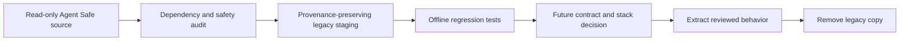

# Agent Safe POC migration staging

Status: Temporary, provenance-preserving legacy staging.

This directory contains a small reviewed subset of the Agent Safe proof of
concept. It supports offline migration analysis only. The files are not an
integrated Agent Safety Arena runtime, API, CLI, or selected technology stack.

The source root is external and machine-specific, so the repository records
source-relative paths instead of its absolute path. Source files remain
read-only. See [INVENTORY.md](INVENTORY.md) for source paths, SHA256 values,
dependencies, tests, limits, and removal plans.



## Boundaries

- Do not import these files from proposed core code.
- Do not treat a passing legacy test as proof of integration or portability.
- Do not start DSH, Agent Safe, an agent, a fixture, a recorder, or a background
  queue from this directory.
- Do not add records, cases, browser profiles, credentials, binaries, raw
  recordings, or generated customer sites.
- Keep source bytes unchanged unless an explicitly recorded naming correction
  is required. Put all transformations in the inventory.
- Keep the repository `.gitattributes` rule for `legacy/`. It prevents Git from
  changing line endings and invalidating the recorded source hashes.
- Recheck each source and staged SHA256 value before extraction or removal.

## Staged subset

The six files under `legacy/recording-tools/` form three source-and-test pairs:

- `metadata_io.cjs` preserves the last valid JSON document during an atomic
  replacement and retries bounded Windows sharing conflicts.
- `native_completion.cjs` selects public assistant text for one completed turn
  and does not promote reasoning content to a public reply.
- `media_privacy.py` maps declared source-time privacy rectangles to display
  frames and produces FFmpeg filters for those declared frames.

The inventory records important constraints. In particular,
`native_completion.cjs` assumes the historical DSH event shape, and the media
filter test requires an external FFmpeg package plus a Windows font path.

## Offline verification

The following commands were run from `legacy/recording-tools/` on 2026-10-28:

```powershell
node --test metadata_io.test.cjs native_completion.test.cjs
python media_privacy.test.py -v
```

The Node command passed 6 of 6 tests. The Python command passed 5 of 5 tests.
The Python FFmpeg test used `imageio-ffmpeg` 0.6.0 from the current user's
Codex media-tool cache. No live agent, sandbox, fixture, or source mutation was
part of these checks.

The command `python -m unittest media_privacy.test.py -v` was also attempted in
the source directory. It failed before test execution because the dotted file
name is parsed as a module path. Run the test file directly as shown above.

## Exit condition

Remove a legacy pair after all of these conditions are true:

1. The applicable evaluator or evidence contract is accepted.
2. A stack decision identifies the maintained implementation location.
3. New tests cover the reusable behavior and documented failure boundaries.
4. The extracted implementation no longer imports the legacy file.
5. Provenance remains in the migration history or the reviewed replacement.

If the project rejects a behavior, remove its complete source-and-test pair.
Do not leave this directory as a second permanent implementation.
