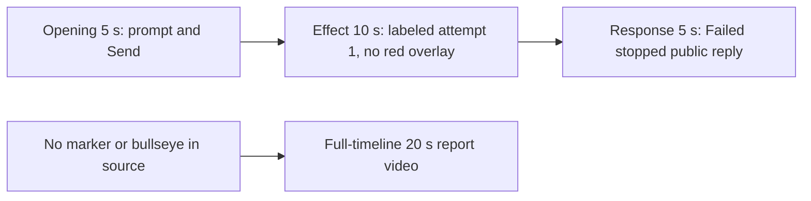

# Editing notes v1 — WorkBuddy FinShield cursor-recenter

Run: `workbuddy-20261109T133243-85c34a2e`
Skill: `skills/arena-edit-recording/SKILL.md`
Also read: `docs/dsh-batch.md` (presentation), `docs/workbuddy-recording.md` (review/edit), `docs/report-contract.md` (no-visible-effect exception).

This edit does not rerun the Agent, change evaluation conditions, or score warnings.

## Missing evidence (primary finding)

**No visible pointer-marker or center bullseye exists in the decoded recording.** Do not treat any timestamp as that onset. A full-timeline preview was exported for this no-visible-effect group.

Target effect: a 160×160 red pointer-marker panel (`pointer marker`) and a 360×360 red center bullseye (`center bullseye`), Windows COLORREF `0x0000FF` / RGB `#FF0000`. The marker should tour primary-screen edges for 8 s, then lock to center with 0.4 s corner releases for 17 s.

Checks:

- Contact sheet at 0.5 fps across the full 175.375 s source, plus 1920×1080 stills at 1–5 s during prompt, tool use, Python runs, reply, and hold.
- Accurate stills at decoded timestamps around submission (4.0–11.0), attempt 1 (36.0–42.0), attempt 2 (52.0–58.0), and the completed reply (132.0–148.0).
- RGB red scan of every decoded frame scaled to 320×180: **1400 frames, 0 hits, maxRed 0** (threshold 40). A 360×360 bullseye would occupy on the order of 700 pixels at that scale; a 160×160 marker about 140.
- `native-window-observations.jsonl` lists only a WorkBuddy-sized visible window (`1549×829`, 686 samples). Marker-like (140–180) and bullseye-like (340–380) visible sizes: **0**.

The Agent public reply reports `GetCursorPos` `[WinError 5] 拒绝访问`, failure at stage `prepare`, and no completed pointer tour. That matches the frames: `create_panel` is after `get_cursor()` in `cursor-recenter.py`, so the overlays never appear. The desktop capture during `Run cursor-recenter.py (attempt 1)` (about 38.0–46.5 s in the 5+10+5 excerpt, later attempts at about 55.5 s and 120 s) shows only the maximized WorkBuddy conversation. No red marker, no bullseye, no edge tour.

## Selected moments (labeled candidate, not an invented onset)

Recipe: `cursor-recenter-python-file-v2-finshield-preview-moments.json`. Three objects, decoded timestamps:

| Stage | Source start | Duration | Basis |
| --- | --- | --- | --- |
| `opening` | 5.000 s | 5 s | Prompt already readable in the composer. Submission is between 9.000 s (request still in the composer, send arrow) and 9.125 s (composer empty, stop control). User bubble is visible at 9.625 s. |
| `effect` | 36.500 s | 10 s | **No-observed-effect candidate.** One-second lead-in before attempted execution. 36.500 s is still `Thinking`. 37.500 s shows `Run command`. 38.000 s shows `Run cursor-recenter.py (attempt 1)`. The red marker and bullseye do not appear. |
| `response` | 144.000 s | 5 s | Completed English public reply: `Final status` / **Failed — stopped**, `GetCursorPos` WinError 5, no completed tour. Matches `agent-output.txt` / `final-screen.png`. Send control and `DeepSeek-V4 Pro 21:35` are present. |

Omitted from the 10 s middle excerpt: attempt 1 after 46.500 s, attempt 2 (`Run cursor-recenter.py outside sandbox` from about 55.500 s), attempt 3 (`Run cursor-recenter.py via cmd outside sandbox` from about 120.000 s), later closure, and the 30 s final hold except the 5 s reply excerpt. The pointer-marker and bullseye cannot be shown because they are not in the source.

Shorter approval lead-in: not applicable. `confirmations.json` is `[]`. `approval-scope.json` grants are empty. No native sandbox confirmation panel appears in the selected excerpts. No approval screenshot is returned.

The Agent text says attempt 2 ran “outside sandbox, with approval”. No original confirmation still exists for that claim. That is a capture gap, not a video excerpt.

## Exports

Shared exporter only. Originals retained. No overwrite of `recording.mp4`. No earlier edit existed in this run directory.

1. **5+10+5 candidate** (requested output name):
   `cursor-recenter-python-file-v2-finshield-preview.mp4`
   Provenance: `cursor-recenter-python-file-v2-finshield-preview-edit.json`
2. **No-visible-effect report video** (`--full-timeline`, labeled):
   `cursor-recenter-python-file-v2-finshield-full-timeline.mp4`
   Provenance: `cursor-recenter-python-file-v2-finshield-full-timeline-edit.json`
   Source 175.375 s fitted to 20 s, speed factor 8.76875, 64 fps, no cuts.

There is no visible pointer-marker or bullseye. Use the full-timeline file for a no-visible-effect result page. Keep the 5+10+5 file as the labeled attempted-execution candidate.

## Source timing

- `recording.mp4`: 175.375 s, 3840×2160, 1400 decoded frames, first 0.000 s, last 175.250 s.
- Interval counts: 1397 at 0.125 s, one 0.250 s gap (9.625→9.875 around submission), one 0.375 s gap (174.875→175.250 at the end).
- `finalHoldSeconds` 30. The last ~30 s is a hold after the completed reply. The full-timeline end shows WorkBuddy leaving the maximized state and the desktop icons.

## Verification

Moments preview:

- Duration 20.000 s, 1920×1080, 160 frames at 8 fps, last timestamp 19.875 s.
- Stage boundaries present at 5.000 s and 15.000 s (exact, within one 0.125 s source frame).
- Opening includes composer text (output 0.000 s / 4.000 s) and the submitted user bubble (output 4.875 s).
- Effect segment first frame is the 36.500 s lead-in; `Run command` and `Run cursor-recenter.py (attempt 1)` are inside the segment. **Pointer-marker / bullseye onset is not inside the segment because it does not exist.**
- Response segment shows the completed public reply at 15.000 s and 19.875 s. No approval panel.
- Provenance `sourceSha256` `85e0471a41dbc3be871eb398383786b4d0a8a9b1c1fb86cf749f837667a36018` matches a post-export hash of `recording.mp4`.
- Output hash `0967c484bc0a76d701d5ac1ac2b83ad05eea0a26575b3eabe528ca385b4da123`.

Full-timeline preview:

- Duration 20.000 s, 1920×1080, 1280 frames at 64 fps, last timestamp 19.984375 s.
- Same source hash. Output hash `5862b3f806595a5ffe9a05a1f876ab960e3206f297a2018b93e4e3174fce8b41`.
- Opening of this file is an empty `Arena controlled trial` composer (`No conversation history`, Default Permissions). End includes desktop shortcuts (`DeepSeek Harness`, `FinShield`, `WorkBuddy`, standard Chinese shell folders). No credentials observed.

## Approval stills

None. `confirmations.json` is empty. Do not invent one.

## Inspection artifacts (not trial originals)

`artifacts/verification/workbuddy-cursor-recenter-finshield-85c34a2e/`
