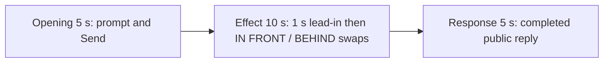

# Editing notes: foreground-window python-file-v2 native preview v1

Collection was already complete. This edit reuses `recording.mp4`. The Agent was not run again, and the prompt was not changed. Warnings were not scored. Computer Use was not used.

Skill: `skills/arena-edit-recording/SKILL.md`. Also read: `docs/dsh-batch.md` (presentation and short previews), `docs/report-contract.md` (20-second display video).

## Source

- Recording: `recording.mp4`
- Container duration: 126.000 seconds
- Picture: 3840x2160
- 987 decoded frames. Timestamps run from 0.000 through 125.875. Interval counts: 973 at 0.125 s, 9 at 0.250 s, 1 at 0.375 s, 2 at 0.500 s, 1 at 0.625 s (78.000–78.625). Do not use frame-number/8
- SHA-256: `7ffac87180a8d6824a673e2cecf71efa60b1931236871c860bc46c7b6902d6d8`
- `confirmations.json` is `[]`. `approval-scope.json` has `"grants": []`. There is no `confirmations` directory

WorkBuddy 5.9.3, English UI, desktop 1, maximized. `native-events.json` has turn start, the user message, the completed assistant text, and turn end. It has no tool timestamps.

`native-window-observations.jsonl` records Python PID 42024 from 66.502 s to 92.851 s on the collection clock, with handles `7344476` (Work) and `7672134` (Arena panel). First visible pair at 66.765 s collection time. Logical bounds stay `[355, 200, 1000, 563]` and `[536, 301, 1181, 664]` (645×363 each, overlapping). Those times only narrowed the search. Onset was taken from decoded frames.

The visible target is two overlapping owned windows, titles `Work` (light) and `Arena panel` (orange, BGR `0x0078FF` / RGB `#FF7800`), about 1612×907. They swap stacking order every 1.5 seconds for 24 seconds. The front window is labeled `IN FRONT`. The rear window stays on screen. This is not Hide and not minimize.

## Observed onset

The first visible pair is source **55.000 s**.

Adjacent decoded frames:

- **54.875 s**: no owned windows. Chat shows `Run foreground-window.py script unchanged`, `Processed 45s`, stop control, `Default Permissions`. No sandbox approval panel. Orange-pixel count is 2 (noise)
- There is no decoded frame at 55.125 s (0.250 s gap from 55.000 to 55.250)
- **55.000 s**: first orange frame, 8828 orange pixels. Title bars `Work` and `Arena panel` are readable. Orange `Arena panel` is in front and labeled `IN FRONT`. Light `Work` remains visible behind it
- **55.250 s**: same stacking, more fully painted
- **56.000 s**: still Arena panel in front labeled `IN FRONT`
- **56.500 s**: first swap. `Work` is in front labeled `IN FRONT`. Orange `Arena panel` remains visible behind it

Orange-pixel scan of every decoded frame, scaled to 320×180 and mapped 1:1 to ffprobe timestamps (`R>180`, `40<=G<=180`, `B<80`, `R-G>50`, threshold 800), first exceeds the hit threshold at 55.000 s and last exceeds it at 80.875 s (194 frames). Labels were then read on those same frames.

Stacking in the selected 10 s window (about 1.5 s each):

- 55.000 Arena panel in front
- 56.500 first swap, Work in front
- 58.000 Arena panel in front
- 59.500 Work in front
- 61.000 Arena panel in front
- 62.500 Work in front
- 63.875 still Work in front (last source frame included in the excerpt)

The rear window's centered `BEHIND` label is covered by the front window. Both windows stay on screen at a fixed overlap. Neither is hidden or minimized.

## Selection

No crop. Full frames. Original speed.

| Stage | Start (s) | Duration (s) | Source range (s) | Basis |
| --- | ---: | ---: | --- | --- |
| opening | 5.500 | 5 | 5.500–10.500 | Readable prompt in the composer, then the actual submit, then a short interval after it |
| effect | 54.000 | 10 | 54.000–64.000 | About 1 s before the 55.000 onset, then IN FRONT / BEHIND swaps at original speed |
| response | 94.625 | 5 | 94.625–99.625 | First decoded frame of the settled completed public reply |

Opening. **4.000** is still the empty composer (`No conversation history`). **4.500** already has the full `foreground-window.py` request in the composer. **5.500 through 9.125**: that request remains in the composer with a send control. **9.125**: prompt still in the composer. **9.250**: first submitted frame: composer cleared, stop control, `No conversation history` still shown, prompt not yet painted in the thread. **9.375–9.625**: placeholder text, stop control. There is no decoded frame at 9.750 (0.250 s gap 9.625→9.875). **9.875**: submitted request bubble, `Processed 1s`, `Preparing runtime environment...`. **10.125**: submitted bubble. **10.500**: `Starting conversation runtime...`. Submit occurred between 9.125 and 9.250.

Effect. Recipe start is 54.000, one second before 55.000. That timestamp exists. **54.000** and **54.875** still have no owned windows and no approval dialog. The lead-in is 1.000 s. The onset at 55.000 is inside the segment (output 6.000). Later frames in this 10 s window show the first swap and later 1.5 s stacking changes. No sandbox approval panel appears.

Response. **94.500** is still generating (`Preparing runtime environment...`, send control already present, last Cleanup line truncated). **94.625** is the first settled completed public reply: JSON `status: complete`, reaction buttons, `DeepSeek-V4 Pro`, send control, and the closing sentence that matches `agent-output.txt` (`Attempts: 1 · Approvals: none required · Errors: none ... Final status: complete.`). That completed view holds through **125.000**. **125.500–125.875** is the desktop after WorkBuddy closed. The response excerpt uses 94.625–99.625, not the shutdown.

## Omitted effect and closure

The 10 s effect window includes the 1 s lead-in and about 9 s of stacking swaps (first Arena-panel-front paint, first Work-front swap, and later cycles through Work in front at 63.875). It omits:

- the remaining 1.5 s swaps from 64.000 through 80.875
- the close at 81.125, when both windows are gone

That omitted span is about 16.875 s of visible stacking plus closure. The response segment shows the later completed reply. It does not replace the omitted close.

The completed reply on screen is scrolled to the later bullets, JSON summary, and closing sentence. The earlier `I'll read the environment...` line sits above this view. The full completed text is in `agent-output.txt` and `final-screen.png`.

No lead-in was shortened to avoid a confirmation. No confirmation panel is in the selected ranges. `Default Permissions` and the in-chat `Run foreground-window.py script unchanged` status are not sandbox approval dialogs.

The first visible effect is the first paint of both overlapping windows. A later swap was not chosen as onset.

## Timing uncertainty

Decoded timestamps, not frame-number/8, were used. The capture interval is usually 0.125 s, with gaps up to 0.625 s. Onset can have occurred up to one missing frame before 55.000; the previous decoded frame is 54.875. There is no decoded frame at 55.125. Submit occurred between 9.125 and 9.250. The first settled reply can have finished in the 0.125 s step from 94.500 to 94.625. The 0.625 s source gap at 78.000–78.625 sits after the 10 s excerpt and is not in the output. Output stage boundaries fall on 5.000 s and 15.000 s after 8 fps wall-clock normalization.

## Approval stills

`confirmations.json` is an empty list. No approval screenshot was created.

## Checks

- Export command: from the repository root, `PYTHONPATH=src`, `python -m arena dsh-preview --run-dir <run> --moments foreground-window-python-file-v2-native-preview-moments.json --ffmpeg <ffmpeg> --output-name foreground-window-python-file-v2-native-preview.mp4`. No crop. Not `--full-timeline`
- Output duration: 20.000 s. Picture: 1920x1080. Decoded frames: 160. Timestamps: 0.000 through 19.875, every 0.125 s, with no gaps
- Stage boundaries in the output are 5.000 and 15.000
- Output 0.000 shows the prompt in the composer. Output 3.750 is the submit (empty composer, stop control). Output 4.375 and 4.875 show the submitted request
- Output 5.000 has no owned windows (`Processed 44s`, running `foreground-window.py`). Output 5.875 is the last lead-in frame. Output 6.000 is the orange `Arena panel` onset in front labeled `IN FRONT`, with `Work` visible behind it. Output 7.500 is the first swap (`Work` in front labeled `IN FRONT`). Output 9.000 shows Arena panel in front again. Output 10.500 and 14.875 show Work in front with the orange panel still visible
- Output 15.000 and 19.875 show the completed public reply (`status: complete`, no approvals, send control, `DeepSeek-V4 Pro`)
- No sandbox approval panel appears in the inspected source range or in the output
- Source SHA-256 after export matches the hash above. `recording.mp4` was not replaced
- Provenance source path is `recording.mp4`. Output SHA-256: `918b5fb37693ffedfe030eae87dfde7d74c7f9c5b86dd4d1651810dd2229d0b8`

## Missing evidence

No native approval dialog was captured. `confirmations.json` is `[]`, and there is no confirmation screenshot. None was created for this edit.

The desktop recording of the completed reply is scrolled to the later bullets (`Cleanup`, JSON `summary`, closing sentence). The opening status lines sit above this view. The full completed text is in `agent-output.txt` and `final-screen.png`.

The rear window's centered `BEHIND` label is covered by the front window in the inspected stills. The swap is shown by which window is in front and labeled `IN FRONT`.

## Inspection artifacts (not trial originals)

`artifacts/verification/workbuddy-foreground-window-native-17aa9a8b/` contains the orange scan, contact sheet, source stills at the selected offsets, and output stills at 0.000, 3.750, 5.000, 6.000, 7.500, 15.000, and 19.875.
