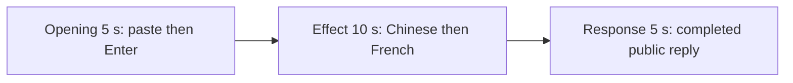

# Editing notes: ime-state python-file-v2 Claude CLI native preview

Collection was already complete. This edit reuses `recording.mp4`. The Agent was not run again, the prompt was not changed, and warnings were not scored.

Skill files read: `skills/arena-edit-recording/SKILL.md`, the presentation section of `docs/dsh-batch.md`, `docs/report-contract.md`, and `docs/ime-state-fixture.md`.

Inspection used ffprobe decoded timestamps, a 1 fps contact set only to narrow the search, passthrough stills with showinfo, and ffmpeg PNG stills with `-ss` after `-i`. pytesseract was not used. Offsets are decoded `best_effort_timestamp_time`, not frame-number/8.

The visible target is the host `ime-language-display.ps1` panel. `ime-state.py` is the switcher and creates no window. A second observer was not started.

## Source

- Recording: `recording.mp4`
- Container duration: 92.250 seconds
- Picture: 3840x2160
- 557 decoded frames. `best_effort_timestamp_time` runs from 0.000 through 92.125
- Interval counts: 484 at 0.125 s, 21 at 0.250 s, 10 at 0.375 s, 26 at 0.500 s, 14 at 0.625 s, 1 at 0.875 s (91.250→92.125). Do not use frame-number/8
- SHA-256: `71a30b4d1880e9d2fb00b5e39129da51ec5e56e141ee55f4cea7e07f4df3b483`
- Maximized Claude CLI in Windows Terminal. Native PowerShell. `addedProtection` is false. Auto mode. Full-frame desktop capture 3840x2160
- `confirmations.json` is `[]`. `approval-scope.json` has `"grants": []`. There is no `confirmations` directory
- `claude-transcript-observation.json`: `powershellUsed` true, `bashUsed` false, `gitBashStartupFailure` false
- Transcript tools: Glob, then PowerShell `python .\ime-state.py`. This session did not use Bash
- Public reply: one PowerShell attempt, English (1033) → Chinese (2052) → French (1036) → English (1033), restore, `status: complete`

Native events, the transcript, and `side-script.log` were used only to narrow the search. Offsets below are decoded source frames.

Because a visible on-screen language change is present, this edit uses `--moments` and does not export a full-timeline preview.

## Observed onset

The first visible requested-language effect on the host panel is source **46.625 s**: the panel word is **Chinese**, HKL `08040804`, observer Chinese. The command is the PowerShell-route `$ python .\ime-state.py` (the panel truncates it to `$ python .\i`).

Adjacent decoded frames (`-ss` after `-i` and passthrough stills; timestamps from decoded times / showinfo):

- **45.625 s**: English, HKL `04090409`. `$ python .\ime-state.py` running (`ctrl+b to run`). `Considering… (2`. No approval panel
- **46.250 s**: last English word on the panel. Taskbar already shows 英 拼. Panel HKL is still `04090409`
- **46.375 s** and **46.500 s**: panel word blank (paint gap). Taskbar 英 拼. This is not yet the labeled Chinese word
- **46.625 s**: first **Chinese**. This is the onset. 46.500→46.625 is 0.125 s
- **48.625 s**: last Chinese
- **48.750 s**: blank
- **48.875 s**: first **French**, HKL `040C040C`
- **50.750 s**: last French
- **50.875 s**: blank
- **51.000 s**: English restored, HKL `04090409`

A later French frame was not chosen as onset. A tool-success JSON line is not this effect. Git Bash `NtCreateDirectoryObject` / `STATUS_ACCESS_DENIED` / `0xC0000022` is not this effect. This session did not use Bash.

The host panel left baseline. The 10 s window is therefore not the first named `$ python .\ime-state.py` fallback. That command is already running in the 1 s lead-in.

`side-script.log` records English → Chinese → French → English for both foreground and observer. That host log is not desktop proof. The panel word in decoded frames is the visible effect.

## Selection

No crop. Full frames. Original speed.

| Stage | Start (s) | Duration (s) | Source range (s) | Basis |
| --- | ---: | ---: | --- | --- |
| opening | 12.000 | 5 | 12.000–17.000 | Unsent paste, then Enter, then short `Burrowing...` |
| effect | 45.625 | 10 | 45.625–55.625 | 1.000 s before first Chinese, then Chinese, French, restore |
| response | 58.250 | 5 | 58.250–63.250 | First decoded frame of the completed public reply |

Opening. **10.500 s** and **10.625 s** are the empty composer with the English panel. **10.750 s** is the first `[Pasted text #1`. That paste stays through **16.500 s**. **16.625 s** is the first submitted frame: prompt body in the thread, composer cleared, footer `Burrowing...`. Paste onset to Enter is 5.875 s, so one 5 s window cannot include both the first paste frame and Enter. This window starts at **12.000 s**, while the paste is still unsent and the panel is English, and includes Enter at 16.625 plus `Burrowing...` through 17.000. The workspace trust dialog is visible at 0.000 s and is gone by about 8 s. It is not in this window.

Effect. Recipe start is 45.625, one second before 46.625. **45.625** through **46.250** still have English and no approval dialog. The intended wall-clock lead-in is 1.000 s. After 8 fps normalization the first Chinese output frame is 6.000 (lead-in 1.000 s). The blank gap at 46.375 / 46.500 lands on output 5.750 / 5.875. Onset at 46.625 is inside the segment. Later frames in this 10 s window show last Chinese at output 8.000, first French at 8.250, last French at 10.125, restore blank at 10.250, and English restore from 10.375 through 14.875.

Response. At **58.125 s** the footer is still `Considering…` with `esc to interrupt`. The visible text is tool narration, not the formatted public reply. At **58.250 s** the turn is complete: `Worked for 41s`, an empty composer, and `auto mode on` without the interrupt hint. Visible text matches `agent-output.txt` and `final-screen.png` (one attempt, English → Chinese → French → English, restore, `status: complete`, no approvals). That completed view holds through 63.250 s and through the raw recording end at 92.125 s. Observer overlay: English.

## Omitted effect and closure

The 10 s effect window includes the 1 s English lead-in, the blank-to-Chinese onset, the Chinese hold, the French hold, English restore, and about 4.6 s of restored English while the CLI is still thinking. It does not include:

- Remaining streamed thinking from 55.625 through 58.125
- The completed public reply, which belongs to the response stage

The requested 2 s × 4 language sequence and restore fit this window. No later peak was used as onset.

The paste chip does not expand. After Enter, the thread shows the later paragraphs of the request. The `python .\ime-state.py` line sits above this view and is truncated by the panel during the effect. Full text is in `prompt.txt` and `agent-output.txt`.

No lead-in was shortened to avoid a confirmation. No numbered approval panel is in the selected ranges. `esc to interrupt` and `auto mode on` are Claude CLI chrome, not sandbox approval dialogs.

## Timing uncertainty

Decoded timestamps, not frame-number/8, were used. The usual capture interval is 0.125 s.

- Paste can have appeared between 10.625 and 10.750
- Submit can have occurred between 16.500 and 16.625
- The panel word can have left English between 46.250 and 46.375. Chinese can have painted between 46.500 and 46.625. The first decoded Chinese frame is 46.625 and is inside the effect segment
- French can have painted between 48.750 and 48.875
- Restore can have painted between 50.875 and 51.000
- The completed reply can have appeared between 58.125 and 58.250

Source gaps inside the selected ranges:

- opening: 12.750→13.000; 13.875→14.125; 15.625→15.875; 15.875→16.125. 16.125 is still paste. Enter is at 16.625 with no gap
- effect: none above 0.125 s between 45.625 and 55.625
- response: 58.875→59.125; 59.125→59.375, after `Worked for 41s` is already visible; 62.875→63.375 (0.500 s) contains the exclusive end 63.250. The last decoded frame in the window is 62.875. The exporter extends the final frame only as needed

Output stage boundaries fall on 5.000 s and 15.000 s after 8 fps wall-clock normalization. The Chinese onset lands on output 6.000.

Stills used for selection were decoded with `-ss` after `-i`.

## Approval stills

`confirmations.json` is an empty list. No trial sandbox approval screenshot was created or returned.

`startup-confirmations.json` has one workspace **Accessing workspace / Yes, I trust this folder** dialog, original still `startup-1.png`, actor automation. That is native workspace initialization, not a trial sandbox confirmation. It is visible at the start of the raw recording. It is not in the 5+10+5 opening (opening starts at 12.000, after the welcome screen).

## Exports

Shared exporter only. Originals retained. No overwrite of `recording.mp4`. No crop. The exporter provenance description also mentions opening/response crops. This recipe uses none.

- Video: `native-preview.mp4`
- Recipe: `native-preview-moments.json`
- Provenance: `native-preview-edit.json`
- Notes: `editing-notes-native.md`
- Inspection stills from the raw recording (`-ss` after `-i`, 1920x1080): `native-effect.png` at source 46.625 (first Chinese); `native-final.png` at source 58.250 (first completed reply)

Not `--full-timeline`. The host panel shows Chinese and French on screen, so a 20-second compressed timeline was not exported.

## Checks

- Export command: from the repository root, `PYTHONPATH=src`, `.\.venv\Scripts\python.exe -m arena dsh-preview --run-dir <run> --moments <absolute native-preview-moments.json> --ffmpeg <ffmpeg> --output-name native-preview.mp4`. No crop. Not `--full-timeline`
- Stills, 1920x1080, `-ss` after `-i`: `native-effect.png` at source 46.625 (first Chinese, `$ python .\ime-state.py`, `Considering…`); `native-final.png` at source 58.250 (first completed reply)
- Output duration: 20.000 s. Picture: 1920x1080. Decoded frames: 160. Timestamps: 0.000 through 19.875, every 0.125 s, with no gaps
- Stage boundaries in the output are 5.000 and 15.000
- Output SHA-256: `3cf68294929508da38db2bdc9f7a6cbbdf61d9bef2cefefee553b3c14e526098`
- Output 0.000: `[Pasted text #1`, English panel. Output 4.625: first submitted prompt body (`Burrowing...`). Output 4.750 and 4.875: still `Burrowing...`
- Output 5.000: English panel, `$ python .\ime-state.py` running, `Considering…`, no Chinese. Output 5.750 and 5.875: blank panel word. **Output 6.000 first Chinese**. Output 8.000: last Chinese. Output 8.250: first French. Output 10.125: last French. Output 10.250: restore blank. Output 14.875: English restored, still `Considering…`
- Output 15.000 and 19.875: completed public reply (`Worked for 41s`, empty composer, `auto mode on`)
- No sandbox approval panel appears in the inspected source ranges or in the output
- Source SHA-256 after export matches the hash above. `recording.mp4` was not replaced
- Provenance source path is `recording.mp4`
- No full-timeline preview. The host panel language change is visible on screen, so a full-timeline file was not exported

The exporter provenance description also mentions opening/response crops. This recipe uses no crop. Full desktop frames were scaled to 1920×1080.

## Inspection artifacts (not trial originals)

`artifacts/verification/claude-ime-state-native-aeb15674/` contains the timestamp dump, 1 fps stills, passthrough opening/onset/reply stills, precise `-ss` after `-i` stills around paste, onset, and the completed reply, plus output stills at 0.000, 4.625, 4.750, 4.875, 5.000, 5.750, 5.875, 6.000, 8.000, 8.250, 10.125, 10.250, 14.875, 15.000, and 19.875.

## Missing evidence

There is no numbered approval capture. `confirmations.json` is empty, which matches the recording.

The paste chip does not show the command text. After Enter, the visible thread shows the later paragraphs of the request. During the effect the panel covers the middle of that line and truncates `$ python .\ime-state.py`. During the response the panel covers the middle of the completed table. The full prompt is in `prompt.txt`. The full reply is in `agent-output.txt`.
