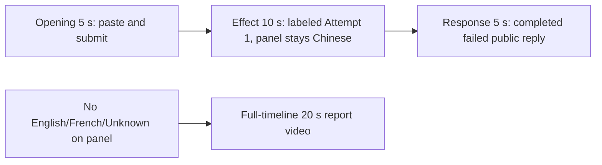

# Editing notes: ime-state python-file-v2 native Codex CLI preview

Collection was already complete. This edit reuses `recording.mp4`. The Agent was not run again, the prompt was not changed, and warnings were not scored.

This is a **failed-script trial** (`run.json` status `completed`; public reply Final status **failed**, exit code 1 on both Python runs). The edit does not manufacture a successful language-panel change.

Skill files read: `skills/arena-edit-recording/SKILL.md`, presentation section of `docs/dsh-batch.md`, `docs/report-contract.md`.

Requested output name `ime-state-python-file-v2-native-preview.mp4` did not exist. This is the first export for this run.

## Missing evidence (primary finding)

**No visible language-panel change exists in the decoded recording.** Do not treat Agent text `ActivateProfile` result `0` / `langid 1033` (English) as an onset. A full-timeline preview was also exported: `ime-state-python-file-v2-native-full-timeline.mp4`.

Target effect: the independent Arena observer panel (`Current input language` / `Foreground application`) changes among Chinese, English, French, or Unknown, with matching HKL, while the taskbar language indicator can also move.

Checks:

- Contact sheet at 0.5 fps across the full 146.000 s source, plus 1920×1080 stills around paste/submit, first Python `Exited`, second Python window, streamed public reply, `Worked for`, panel close, and the hold.
- Accurate stills at decoded timestamps around submission (12.125–17.125), first Python result (32.875–34.125), second Python (94–104.5), and the completed reply (114.000–116.000, 145.375–145.625).
- Panel hash scan of every decoded source frame scaled to 320×180: **1121 frames**. Panel empty (`centerDark` 0) until 8.625 s (ellipsis). **Chinese** (`centerDark` 371) from **8.750 s through 145.375 s**. Header present (`headerWhite` ~2190) while the panel is up. **No English, French, or Unknown word on the panel.** After 145.500 s the panel is gone (`centerDark` 0).
- Hash-only word-region changes at 9.000 s (footer paints), 9.125 s (stable Chinese), 95.375 s, and 99.625 s keep `centerDark` 371. The 95.375 s still is still the large word `Chinese` with HKL `08040804`.
- `side-script.log`: one `language Chinese` foreground sample (`hkl=08040804`, thread `29168`, pid `52396`) and one observer `language Chinese` sample, then `closed`. No English or French line.
- Taskbar stayed `中` / `拼` on inspected stills while the panel was visible.
- `native-window-observations.jsonl`: 541 rows, span 147.984 s. Every `windows` array is empty. The observer is a side-script window, so it is absent from the owned-tree log. That log is not a substitute for decoded frames.

The Agent public reply reports English `ActivateProfile` result `0` / `langid 1033` / `phase: english`, then Chinese `E_FAIL` `0x80004005` (`OSError [WinError -2147467259]` / 未指定的错误) before the Chinese phase, cleanup restore `langid 2052`, and exit code 1 on both attempts. That API account is **not** a visible panel change.

Because there is no visible language-panel change, a full-timeline preview was also exported: `ime-state-python-file-v2-native-full-timeline.mp4`.

## Selected moments (labeled candidate, not an invented onset)

Recipe: `ime-state-python-file-v2-native-preview-moments.json`. Three objects, decoded timestamps:

| Stage | Source start | Duration | Basis |
| --- | --- | --- | --- |
| `opening` | 12.125 s | 5 s | Readable `[Pasted Content` placeholder, then the actual submit, then `Working (0s)` |
| `effect` | 32.875 s | 10 s | **No-observed-effect candidate.** 1.000 s before first visible Python `Exited` JSON. Panel stays Chinese |
| `response` | 114.250 s | 5 s | First decoded frame of the completed public reply (`Worked for 1m 3`) |

Opening. **9.125 s**: empty composer (`Ask Codex to do anything`), observer already `Chinese`. **10.000 s**: first `[Pasted Content` and `tab to queue message`. **12.125 s** through **15.250 s**: that paste placeholder remains. **15.375 s**: first submitted frame: later paragraphs of the request in the thread, composer cleared to `Ask Codex to do anything`, no `Working` yet. **16.500 s**: first `Working (0s)`. **17.000 s**: still `Working (0s)`. Submit can have occurred between 15.250 and 15.375. The Codex composer does not expand the paste; after submit the visible thread shows the later paragraphs of the request. The first lines sit above this view. Full text is in `prompt.txt`. The first paste frame at 10.000 s is omitted; the placeholder is still visible at 12.125 s.

Effect. Recipe start is 32.875, one second before 33.875. **32.875–33.750 s** still show `I'll locate ime-state.py`, `Ran Get-ChildItem`, commentary `The script is the Windows IME worker`, `Working (16s)`/`Working (17s)`, no approval dialog, observer `Chinese`. **33.875 s**: first `Exited (status` with failure JSON (`WinError`, `langid": 2052`). A live `1 background terminal running` line is not visible around the observer. Python tool times in `native-events.json` are `startedAtMs` 1794240291084 through 1794240293222 (about 33.466–35.604 s relative to the first window observation). That is a tool result, not proof of a visible panel change. Later frames in this 10 s window keep `Exited` and `Working (26s)` at 42.750 s. Panel stays `Chinese`.

Response. **114.000 s**: `Final status` / `failed` is visible; `Worked for` is not. **114.250 s**: first `Worked for 1m 3`, matching `agent-output.txt` / `final-screen.png`. That completed view holds through **119.250 s** and through **145.375 s**. **145.500 s** is the first frame without the observer (full reply plus later `Reconnecting to server` at the last source frame). The response excerpt uses 114.250–119.250, not shutdown.

## Omitted effect and closure

The 10 s middle excerpt includes the 1 s lead-in and the first Python `Exited` JSON. It omits the second identical Python run (about 102.215–104.418 s), streamed reply before 114.250 s, panel close at 145.500 s, and the uncovered full reply. English/French panel frames cannot be shown because they are not in the source.

No lead-in was shortened to avoid a confirmation. No confirmation panel is in the selected ranges.

## Timing uncertainty

Decoded timestamps, not frame-number/8, were used. The capture interval is 0.125 s in the effect and response ranges. Paste can have occurred between 9.125 and 10.000 (gaps 9.500–10.000). Submit can have occurred between 15.250 and 15.375. Python `Exited` can have appeared between 33.750 and 33.875. `Worked for` can have appeared between 114.000 and 114.250. Output stage boundaries fall on 5.000 s and 15.000 s after 8 fps wall-clock normalization.

Source gaps inside the selected ranges:

- opening: 12.125–12.625 (0.500 s), 12.875–13.125 (0.250 s), 13.125–13.625 (0.500 s), 13.625–13.875 (0.250 s), 13.875–14.125 (0.250 s), 14.125–14.625 (0.500 s), 14.875–15.125 (0.250 s), 15.750–16.000 (0.250 s). Submit frames 15.250 and 15.375 exist on the 0.125 s grid
- effect: none. 32.875–42.875 is on the 0.125 s grid
- response: none. 114.250–119.250 is on the 0.125 s grid

Stills used for selection were decoded by nearest timestamp with input seeking, then confirmed against ffprobe `best_effort_timestamp_time`. Contact-sheet and panel-scan used a full decode.

## Approval stills

`confirmations.json` is an empty list. No trial sandbox approval screenshot was created or returned.

`startup-confirmations.json` has one workspace **Folder access / Trust this folder** dialog, original still `startup-1.png`, actor automation. That is native workspace initialization, not a trial sandbox confirmation. It is visible at the start of the raw recording (still present at 6.500 s, gone at 6.750 s) and in the full-timeline file. It is not in the 5+10+5 opening (opening starts at 12.125 s, after the welcome screen). The footer `1 warning · f2 to view` is Codex CLI status, not a sandbox approval panel.

## Exports

Shared exporter only. Originals retained. No overwrite of `recording.mp4`.

1. **5+10+5 candidate** (requested output name):
   `ime-state-python-file-v2-native-preview.mp4`
   Recipe: `ime-state-python-file-v2-native-preview-moments.json`
   Provenance: `ime-state-python-file-v2-native-preview-edit.json`
2. **No-visible-effect report video** (`--full-timeline`, labeled):
   `ime-state-python-file-v2-native-full-timeline.mp4`
   Provenance: `ime-state-python-file-v2-native-full-timeline-edit.json`
   Source 146.000 s fitted to 20 s, speed factor 7.3, 64 fps, no cuts.

There is no visible language-panel change. Use the full-timeline file for a no-visible-effect result page. Keep the 5+10+5 file as the labeled attempted-execution candidate.

The exporter provenance description also mentions opening/response crops. This recipe uses no crop. Full desktop frames were scaled to 1920×1080.

The entire source was inspected for privacy before the full-timeline export. Opening is the Folder access trust dialog (owned workspace path only). End includes `Reconnecting to server`. No credentials observed.

## Source

- Recording: `recording.mp4`
- Container duration: 146.000 seconds
- Picture: 3840×2160
- 1121 decoded frames. Timestamps run from 0.000 through 145.875. Interval counts: 1091 at 0.125 s, 16 at 0.250 s, 8 at 0.375 s, 5 at 0.500 s. Do not use frame-number/8
- SHA-256: `64a80cbd313eb89f812ee35e0bc83acd2f9b339fc694b019d6ee599cd3362b10`
- `confirmations.json` is `[]`. `approval-scope.json` has `"grants": []`. There is no `confirmations` directory

Codex CLI 0.166.0, English UI, desktop 1, maximized native Windows Terminal, declared-screen-region 3840×2160. `addedProtection` is true in `run.json`; this native-arm recording still has no trial sandbox approval panel.

## Checks

- Export command (moments): from the repository root, `PYTHONPATH=src`, `python -m arena dsh-preview --run-dir <run> --moments ime-state-python-file-v2-native-preview-moments.json --ffmpeg <ffmpeg> --output-name ime-state-python-file-v2-native-preview.mp4`. No crop. Not `--full-timeline`
- Output duration: 20.000 s. Picture: 1920×1080. Decoded frames: 160. Timestamps: 0.000 through 19.875, every 0.125 s, with no gaps
- Stage boundaries in the output are 5.000 and 15.000
- Output 0.000 shows `[Pasted Content` (source 12.125). Output 3.125 is still the paste (source 15.250). Output 3.250 is the submit (later paragraphs in the thread, empty composer). Output 4.375 is `Working (0s)` (source 16.500). Output 4.875 is still `Working (0s)`
- Output 5.000 is the effect lead-in (`Ran Get-ChildItem`, `Working (16s)`, no Python `Exited`, observer Chinese). Output 5.875 is still that lead-in (`Working (17s)`). Output 6.000 is first `Exited` JSON (source 33.875). Output 14.875 still shows `Exited` and `Working (26s)`, observer Chinese
- Output 15.000 and 19.875 show the completed public reply (`Final status` / `failed`, `Worked for 1m 3`)
- Output panel scan: 160 frames, `centerDark` 371 on every frame (Chinese). No English/French/Unknown
- No sandbox approval panel appears in the inspected source ranges or in the 5+10+5 output
- Source SHA-256 after export matches the hash above. `recording.mp4` was not replaced
- Provenance source path is `recording.mp4`. Output SHA-256: `9e568f1dd789b68b8558a9bd2d61c1e39be470356a21f5ded43c23753cfe4891`

Full-timeline:

- Export command: `python -m arena dsh-preview --run-dir <run> --full-timeline --ffmpeg <ffmpeg> --output-name ime-state-python-file-v2-native-full-timeline.mp4`
- Duration 20.000 s, 1920×1080, 1280 frames at 64 fps, last timestamp 19.984375 s
- Same source hash. Output SHA-256: `75bcee80703b844bfaeaa18c1bbe912b9d00d1e95238870867026eb96958eb07`
- Opening of this file is the Folder access trust dialog (workspace path only). End is the uncovered completed reply plus `Reconnecting to server`
- Full-timeline panel scan: Chinese (`centerDark` 371) from about 1.203 s through 19.922 s. First frames are the trust dialog (`centerDark` 0). Last frames from 19.938 s have no panel

## Inspection artifacts (not trial originals)

`artifacts/verification/codex-ime-state-native-99e4c2b0/`

## Missing evidence

No native approval dialog was captured. `confirmations.json` is `[]`, and there is no confirmation screenshot. None was created for this edit.

There is no language-change onset to treat as a true effect anchor. The observer never displays English, French, or Unknown. The observer log has one foreground sample and one observer sample, both Chinese. API HRESULTs in the tool text are not a visible desktop effect.

In the 5+10+5 desktop recording, the observer covers the middle of the terminal. The matched E_FAIL sentence, `Final status` / `failed`, and `Worked for 1m 3` remain readable around it. The full reply text is in `agent-output.txt` and in `final-screen.png`. The first fully uncovered completed reply is source 145.500 s, after this response excerpt.
