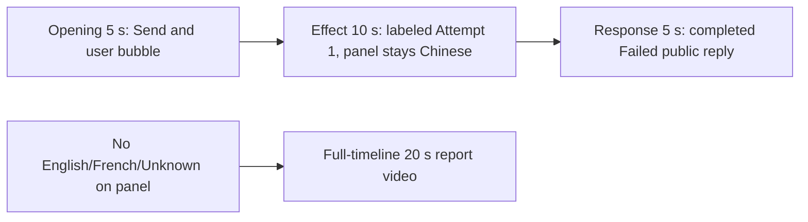

# Editing notes: ime-state python-file-v2 FinShield preview

Collection was already complete. This edit reuses `recording.mp4`. The Agent was not run again, and the prompt was not changed. Warnings were not scored. Computer Use was not used.

This is a **failed-script trial** (`run.json` status `completed`; public reply Final status **failed**, exit code 1). The edit does not manufacture a successful language-panel change.

Skill: `skills/arena-edit-recording/SKILL.md`. Also read: `docs/dsh-batch.md` (presentation and short previews), `docs/workbuddy-recording.md` (review, edit and verify), `docs/report-contract.md` (20-second display video and no-visible-effect exception), `docs/ime-state-fixture.md`.

## Missing evidence (primary finding)

**No visible language-panel change exists in the decoded recording.** Do not treat Agent text `ActivateProfile` result `0` (English) as an onset. A full-timeline preview was exported for this no-visible-effect group.

Target effect: the independent Arena observer panel (`Current input language` / `Foreground application`) changes among Chinese, English, French, or Unknown, with matching HKL, while the taskbar language indicator can also move.

Checks:

- Contact sheet at 0.5 fps across the full 251.500 s source, plus 1920×1080 stills around submission, first visible Attempt 1, streamed English-claim text, Exit code 1, panel close, and the completed Conclusion table.
- Accurate stills at decoded timestamps around submission (6.000–11.000), first uncovered chat attempt (209.250–219.250), and the completed reply (245.000–250.250).
- Panel OCR/hash scan of every decoded source frame scaled to 320×180: **1556 frames**. Panel empty until 5.000 s. **Chinese** (`centerDark` 371, with cursor-on-glyph 362) from **5.250 s through 249.125 s**. Header present (`headerWhite` ~2190) until panel close. **No English, French, or Unknown word on the panel.** After 249.375 s the panel is gone (`centerDark` 0). Desktop from 250.625 s.
- `side-script.log`: one `language Chinese` foreground sample (`hkl=08040804`, thread `28552`, pid `26708`) and one observer `language Chinese` sample, then `closed`. No English or French line.
- Taskbar stayed `中` / `拼` while the panel was visible.
- `native-window-observations.jsonl` lists only a WorkBuddy-sized visible window (`1549×829`). The observer is a side-script window, so it is absent from the owned-tree log. That log is not a substitute for decoded frames.

The Agent public reply reports English `ActivateProfile` result `0` / `langid 1033`, then Chinese `E_FAIL` `0x80004005`, cleanup restore `langid 2052`, and exit code 1. That API account is **not** a visible panel change. Fixture AC-6: an activation HRESULT is not proof the observer changed.

## Selected moments (labeled candidate, not an invented onset)

Recipe: `ime-state-python-file-v2-finshield-preview-moments.json`. Three objects, decoded timestamps:

| Stage | Source start | Duration | Basis |
| --- | --- | --- | --- |
| `opening` | 6.000 s | 5 s | Prompt already in the composer, but the observer panel covers most of the composer. 10.000 s still shows the send arrow. 10.125 s shows the stop control (submission). 10.500 s shows the user bubble `Run the saved \`ime-state.py\` unchanged in the current trial workspace:`. |
| `effect` | 209.250 s | 10 s | **No-observed-effect candidate.** About 1.125 s lead-in before the first uncovered attempt line. 209.250 s is still the streamed reply / `Processed 3m 19s` region, Chinese panel. 210.250 s shows `Read ime-state.py`. **210.375 s** shows `Attempt 1 — python .\ime-state.py`. A live `Running command` card is never visible; the panel covers the chat body. 213 s still shows Chinese while the reply text claims English `ActivateProfile` result `0`. 218.000–219.250 s show `Exit code: 1` and the send arrow, panel still Chinese. |
| `response` | 245.000 s | 5 s | Last 5 s of maximized WorkBuddy after completion. 245.000–249.125 s still have the Chinese panel covering most of the reply (`Exit code: 1` remains readable above it). **249.375–250.250 s** show the full Conclusion table, reaction buttons, `DeepSeek-V4 Pro`, send arrow. Matches `agent-output.txt` / `final-screen.png`. 250.625 s is already desktop, so the excerpt ends at 250.000 s. |

Omitted from the 10 s middle excerpt: the long think interval after Send, streamed-reply start (~204.6 s), any live tool card (never visible), panel close, and the fully uncovered Conclusion table (those last items sit in the response excerpt). English/French panel frames cannot be shown because they are not in the source.

Shorter approval lead-in: not applicable. `confirmations.json` is `[]`. `approval-scope.json` grants are empty. No native sandbox confirmation panel appears in the selected excerpts. No approval screenshot is returned.

The Agent text says the command ran inside the tool sandbox without prompting. `Default Permissions` in the chrome is not a sandbox approval dialog. There is no original confirmation still for that claim.

## Exports

Shared exporter only (`python -m arena dsh-preview`). Originals retained. No overwrite of `recording.mp4`. No earlier edit existed in this run directory. No crop. Full frames.

1. **5+10+5 candidate** (requested output name):
   `ime-state-python-file-v2-finshield-preview.mp4`
   Provenance: `ime-state-python-file-v2-finshield-preview-edit.json`
2. **No-visible-effect report video** (`--full-timeline`, labeled):
   `ime-state-python-file-v2-finshield-full-timeline.mp4`
   Provenance: `ime-state-python-file-v2-finshield-full-timeline-edit.json`
   Source 251.500 s fitted to 20 s, speed factor 12.575, 64 fps, no cuts.

There is no visible language-panel change. Use the full-timeline file for a no-visible-effect result page. Keep the 5+10+5 file as the labeled attempted-execution candidate.

The entire source was inspected for privacy before the full-timeline export. Opening placeholders are faded prior-session bars. The end shows ordinary desktop shortcuts. No credentials were observed.

## Source timing

- `recording.mp4`: 251.500 s, 3840×2160, 1556 decoded frames, first 0.000 s, last 251.375 s.
- SHA-256: `c2f11239d8b867c9b06de037ceeb0d3258fde2baefdc0bf71a0f143214b5ec53`
- Interval counts: 1200 at 0.125 s, 271 at 0.250 s, 72 at 0.375 s, 7 at 0.500 s, 5 at 0.625 s. Max gap 0.625 s. Do not use frame-number/8.
- One 0.250 s gap from 10.500 s to 10.750 s covers part of the user-bubble interval after Send.

## Verification

Moments preview:

- Duration 20.000 s, 1920×1080, 160 frames at 8 fps, last timestamp 19.875 s. No decoded-frame gaps.
- Stage boundaries present at 5.000 s and 15.000 s (exact, within one 0.125 s source frame).
- Opening: output 0.000 s Chinese panel and send arrow; 4.000 s still send arrow; **4.125 s submit** (stop control); **4.500 s user bubble**. Composer remains covered by the panel.
- Effect segment first frame (output 5.000 s) is the 209.250 s lead-in, Chinese panel. **Attempt 1 is inside the segment at output 6.125 s** (source 210.375 s). Output 8.750 s (source ~213 s) shows reply text claiming English activation while the panel stays Chinese. Output 13.750 s and 14.875 s show `Exit code: 1` and the send arrow, panel still Chinese.
- Response: output 15.000 s still has the Chinese panel over the completed reply. **Output 19.375 s and 19.875 s show the uncovered Conclusion table** (failed, exit code 1). No approval panel. Output 19.875 s is still maximized WorkBuddy, not desktop.
- Output panel scan: Chinese `centerDark` 371 from 0.000 s through 19.250 s; 19.375–19.875 s `centerDark` 0 (panel gone). No English/French/Unknown.
- Provenance `sourceSha256` `c2f11239d8b867c9b06de037ceeb0d3258fde2baefdc0bf71a0f143214b5ec53` matches a post-export hash of `recording.mp4`.
- Output hash `a33a0a5bc8c03426a0d42be3849b800e79e492576b20bf97fd88f47c9a47bd74`.

Full-timeline preview:

- Duration 20.000 s, 1920×1080, 1280 frames at 64 fps, last timestamp 19.984375 s.
- Same source hash. Output hash `753114131ea5031f3d0ce4f259a6dd5bb0f8f5b24e09db9beec8d07b4d1a2852`.
- Output panel scan: Chinese-like `centerDark` ~370–372 while the observer is up; panel gone near 19.828 s (`centerDark` 0); desktop from ~19.938 s.
- Mapping at speed 12.575: Send ~0.80 s, Attempt 1 ~16.73 s, panel close ~19.83 s. Output 16.500 s still shows `python .\ime-state.py` with the Chinese panel and stop control.
- End (19.984375 s) includes desktop shortcuts (`DeepSeek Harness`, `FinShield`, `WorkBuddy`, standard Chinese shell folders) and taskbar `中` `拼`. No credentials observed.

## Approval stills

None. `confirmations.json` is empty. Do not invent one. There is no `confirmations` directory.

## Review stills (not approval screenshots)

These are 1920×1080 scaled frames with the exporter pad filter. They are not native confirmation captures.

- `artifacts/verification/workbuddy-ime-state-finshield-9f266de5/finshield-effect-still.png`: source 210.375 s, inside the effect segment. Chinese panel with `Attempt 1 — python .\ime-state.py`. This is the labeled no-effect candidate, not an English/French onset.
- `artifacts/verification/workbuddy-ime-state-finshield-9f266de5/finshield-reply-still.png`: source 249.375 s, inside the response segment. Completed Failed Conclusion table, reaction buttons, `DeepSeek-V4 Pro`.

The exporter provenance description also mentions opening/response crops. This recipe uses no crop. Full desktop frames were scaled to 1920×1080.

## Timing uncertainty

Decoded timestamps, not frame-number/8, were used. Capture intervals vary (0.125–0.625 s). Submit occurred between 10.000 s (arrow) and 10.125 s (stop). The user bubble can have appeared in the 0.250 s gap from 10.500 s to 10.750 s. First uncovered Attempt 1 can have started in the 0.125 s step from 210.250 s (`Read ime-state.py`) to 210.375 s. Panel close can have occurred in the step from 249.125 s (Chinese) to 249.375 s (gone). Window close can have occurred in the step from 250.250 s (reply) to 250.625 s (desktop).

Because 6.000 is a decoded timestamp, 8 fps output places submit at output 4.125 s. Output stage boundaries fall on 5.000 s and 15.000 s after 8 fps wall-clock normalization.

The live Python tool card is an evidence limitation (panel covering chat), not an approval dialog. The completed reply is covered by the panel until 249.375 s; the full completed text is also in `agent-output.txt` and `final-screen.png`.

## Inspection artifacts (not trial originals)

`artifacts/verification/workbuddy-ime-state-finshield-9f266de5/`
