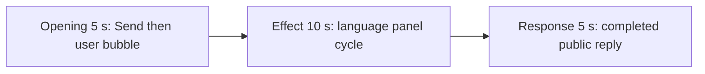

# Editing notes: ime-state python-file-v2 native preview

Collection was already complete. This edit reuses `recording.mp4`. The Agent was not run again, and the prompt was not changed. Warnings were not scored. Computer Use was not used.

Skill: `skills/arena-edit-recording/SKILL.md`. Also read: `docs/dsh-batch.md` (presentation and short previews), `docs/workbuddy-recording.md` (review, edit and verify), `docs/report-contract.md` (20-second display video), `docs/ime-state-fixture.md`.

## Source

- Recording: `recording.mp4`
- Container duration: 82.625 seconds
- Picture: 3840x2160
- 660 decoded frames. Timestamps run from 0.000 through 82.500. Interval counts: 658 at 0.125 s, 1 at 0.250 s (50.250→50.500). Do not use frame-number/8
- SHA-256: `8225f807828a40238cd587d7e089a983a3fa44d0bdf931d607c0338588188083`
- `confirmations.json` is `[]`. `approval-scope.json` has `"grants": []`. There is no `confirmations` directory

WorkBuddy 5.9.3, English UI, desktop 1, maximized. `native-events.json` has turn start, the user message, the completed assistant text, and turn end. It has no tool timestamps.

`native-window-observations.jsonl` records only the WorkBuddy window `[-6, -6, 1543, 823]`. The Arena language panel is a separate side-script process and is not in those rows. Onset was taken from decoded frames.

The owned observer is `ime-language-display.ps1`. It is a separate white topmost window. The title bar is `Current input language`. The header is `Current input language` / `Foreground application`. The large word is the foreground input language. The footer shows the language name, raw HKL, and thread, plus the observer-process layout. The recording also shows the taskbar language icon (`中` / `拼`, `ENG`, `FRA`).

This is input-language switching. The recording does not show Pinyin composition.

`side-script.log` lists foreground Chinese, then English, Chinese, French, English, Chinese. The log was used only to narrow the search. The onset timestamp comes from decoded frames, not from the log.

## Visible language-panel change

There is a visible language-panel change in the decoded source. The 20-second 5+10+5 edit is the display video. A full-timeline preview named `ime-state-python-file-v2-native-full-timeline.mp4` was **not** exported.

## Observed onset

The first visible language change is source **33.125 s**.

Adjacent decoded frames:

- **33.000 s**: observer still shows `Chinese`, `HKL 08040804`, thread `43332`. The taskbar language icon is `中` / `拼`. Chat shows the PowerShell command `python .\ime-state.py` and a stop control. No sandbox approval panel
- There is no decoded-frame gap at the onset: 33.000 then 33.125
- **33.125 s**: the large word and HKL footer clear. The taskbar icon is `ENG`. This is the first frame that is no longer Chinese
- **33.250 s**: still blank. Taskbar remains `ENG`
- **33.375 s**: observer shows `English`, `US keyboard | HKL 04090409 | thread 43332`. Observer process is also `English | HKL 04090409`

A later English or French paint was not chosen as onset.

## Selection

No crop. Full frames. Original speed.

| Stage | Start (s) | Duration (s) | Source range (s) | Basis |
| --- | ---: | ---: | --- | --- |
| opening | 7.000 | 5 | 7.000–12.000 | A few seconds before Send, the actual submit, then the readable user bubble |
| effect | 32.125 | 10 | 32.125–42.125 | 1.000 s before the 33.125 onset, then the four 2-second phases and restore |
| response | 51.250 | 5 | 51.250–56.250 | Settled completed public reply, one source frame after the first settled frame at 51.125 |

Opening. **0.000** through **4.625** is still the empty composer (`No conversation history`). **4.750** is the first observer paint (header, blank word). **4.875** shows baseline `Chinese`. From that time the observer covers the composer, so the pasted request is not readable in the composer. **7.000 through 9.875**: observer `Chinese`, send control, title `Arena controlled trial`. **9.875**: send control still present. **10.000**: first submitted frame (stop control, no user bubble yet). **10.250**: faint user bubble. **10.375**: readable request above the observer (`Run the saved ime-state.py unchanged in the current trial workspace:`). That bubble remains through **12.000**. A 5-second opening cannot also include the empty composer at 4.000–4.625 and the submit at 10.000.

Effect. Recipe start is 32.125, one second before 33.125. **32.125** through **33.000** still show `Chinese`, the running `python .\ime-state.py` job, and a stop control. They do not show a sandbox approval panel. The wall-clock lead-in is 1.000 s. The onset at 33.125 is inside the segment (output 6.000). English is painted at 33.375 (output 6.250). Later frames in this 10 s window:

- 35.250 blank, 35.750 `Chinese`
- 37.375 blank, 37.625 `French` (`HKL 040C040C`, taskbar `FRA`)
- 39.500 blank, 39.625 `English` again
- 41.375 restored `Chinese` word (taskbar `中`); 41.750–42.000 full footer `HKL 08040804`

The last unique effect frame in the export is 42.000, restored Chinese with footer. Recipe end is 42.125.

Response. Accurate output-seek stills: **51.000** still shows `Continuing the task`. **51.125** is the first settled completed public reply: send control, and the opening sentences that match `agent-output.txt` (`The script ran successfully on the first attempt...`, `Attempts: 1 (successful)`). The recipe uses **51.250**, one 0.125 s source frame later, with the same completed picture. That completed view holds through **56.125** and through the later hold. **82.375–82.500** is WorkBuddy leaving the maximized state. The response excerpt uses 51.250–56.250, not the shutdown.

## Omitted effect and closure

The 10 s effect window includes the 1.000 s Chinese lead-in, the 33.125 onset, English, Chinese, French, English, and the restored Chinese paint. It does not omit a later language phase. It omits the later public reply, which is in the response segment.

The observer stays on screen through the 30-second final hold and through the last source frame at 82.500. It covers the later paragraphs of the public reply, including `Final status: complete` and the execution-sequence bullets. The visible reply is the first two lines above the observer. The full completed text is in `agent-output.txt` and in `final-screen.png`. Those are not this desktop still.

No lead-in was shortened to avoid a confirmation. No confirmation panel is in the selected ranges. `Default Permissions` and the in-chat stop control are not sandbox approval dialogs.

The opening omits the empty-composer hold before the observer paints. The observer covers the composer from 4.750, so the readable request in this excerpt is the user bubble from 10.375.

## Timing uncertainty

Decoded timestamps, not frame-number/8, were used. The capture interval is 0.125 s, with one 0.250 s gap at 50.250–50.500, before the response excerpt. The selected ranges have no missing timestamps. The language name can have cleared in the 0.125 s step from 33.000 (Chinese) to 33.125 (blank, `ENG`). English can have painted between 33.250 and 33.375. Submit occurred between 9.875 and 10.000. The first settled reply can have finished in the 0.125 s step from 51.000 (`Continuing the task`) to 51.125.

Because 7.000 is a decoded timestamp, 8 fps output places the submit picture at output 3.000. Output 2.875 is still the send control. Output stage boundaries fall on 5.000 s and 15.000 s after 8 fps wall-clock normalization.

## Approval stills

`confirmations.json` is an empty list. No approval screenshot was created. Sandbox approvals are not presented as video segments.

## Stills

- `native-effect-still.png`: source 33.375, first English paint, inside the effect segment
- `native-reply-still.png`: source 52.000, inside the response segment. It shows the completed public reply
- Both stills are 1920×1080. The scale filter matches the exporter: `scale=1920:1080:force_original_aspect_ratio=decrease` plus white pad

## Checks

- Export command: from the repository root, `PYTHONPATH=src`, `python -m arena dsh-preview --run-dir <run> --moments ime-state-python-file-v2-native-preview-moments.json --ffmpeg <ffmpeg> --output-name ime-state-python-file-v2-native-preview.mp4`. No crop. Not `--full-timeline`
- Output duration: 20.000 s. Picture: 1920x1080. Decoded frames: 160. Timestamps: 0.000 through 19.875, every 0.125 s, with no gaps
- Stage boundaries in the output are 5.000 and 15.000
- Output 0.000 shows observer `Chinese` and a send control. Output 2.875 is the last pre-submit send control. Output 3.000 is the submit (stop control). Output 3.250 is a faint user bubble. Output 3.375 shows the submitted request bubble. Output 4.875 still shows that bubble and a stop control
- Output 5.000 and 5.875 have observer `Chinese` and running `python .\ime-state.py`. Output 6.000 is the blank onset (`ENG` on the taskbar). Output 6.250 shows `English` and `HKL 04090409`
- Output 8.625 shows the Chinese phase. Output 10.500–10.750 show `French`. Output 12.500–12.750 show the second `English`. Output 14.250 is restored `Chinese` without footer. Output 14.875 shows restored `Chinese` with `HKL 08040804`
- Output 15.000 and 19.875 show the completed public reply (`Attempts: 1 (successful)`, send control)
- No sandbox approval panel appears in the inspected source range or in the output
- Source SHA-256 after export matches the hash above. `recording.mp4` was not replaced
- Provenance source path is `recording.mp4`. Output SHA-256: `08f130e8783c2563f43915020d39d23793423349c1c5f94adb372e290ad6e2ee`

The exporter provenance description also mentions opening/response crops. This recipe uses no crop. Full desktop frames were scaled to 1920x1080.

## Missing evidence

No native approval dialog was captured. `confirmations.json` is `[]`, and there is no confirmation screenshot. None was created for this edit.

In the desktop recording, the observer covers the later paragraphs of the public reply, including `Final status: complete`. The first two lines and the completion footer (send control) are visible. The full reply text is outside this video, in `agent-output.txt` and `final-screen.png`.

The 5-second opening cannot show the empty composer (4.000–4.625) and the submit (10.000) together. The observer covers the composer from 4.750, so the readable request in this excerpt is the user bubble from 10.375.

Decoded frames show a visible language change. A full-timeline preview was not exported.

## Inspection artifacts (not trial originals)

`artifacts/verification/workbuddy-ime-state-native-67a4e6e4/` contains source stills at the selected offsets and output stills at 0.000, 2.750, 2.875, 3.000, 3.250, 3.375, 4.375, 4.500, 4.875, 5.000, 5.875, 6.000, 6.250, 8.625, 10.750, 12.750, 14.250, 14.875, 15.000, and 19.875.
