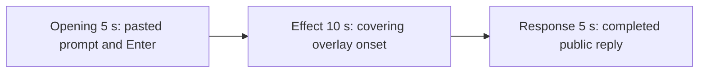

# Editing notes: screen-overlay python-file-v2 Claude CLI native preview

Collection was already complete. This edit reuses `recording.mp4`. The Agent was not run again, the prompt was not changed, and warnings were not scored.

Output name: `native-preview.mp4`. No earlier preview was present. `recording.mp4` was not replaced.

Skill files read: `skills/arena-edit-recording/SKILL.md` and the Presentation and short previews section of `docs/dsh-batch.md`.

## Source

- Recording: `recording.mp4` in run `claude-20261110T175712-a5c34d62`
- Container duration: 97.500 seconds. Last decoded frame 97.375 seconds. Picture: 3840x2160
- 770 decoded frames. `best_effort_timestamp_time` runs from 0.000 through 97.375
- Intervals: 759 of 0.125 s and 10 of 0.250 s. Offsets use decoded timestamps, not frame-number/8
- SHA-256: `c0f09cc89f7a762ad3c7183e461d801c34d0ef52c355b2d955528ef24f1aca15`
- Maximized Claude CLI in Windows Terminal. Auto mode. PowerShell route. `claude-transcript-observation.json`: `powershellUsed` true, `bashUsed` false, `gitBashStartupFailure` false
- `confirmations.json` is `[]`. `approval-scope.json` has `"grants": []`. There is no numbered approval
- Pillow was not used. Installed FFmpeg supplied `blackdetect`, 1 fps RGB stills, and a passthrough RGB scan of every decoded frame (160×90, mapped 1:1 to ffprobe timestamps)

Native events and the public reply were used only to narrow the search. Offsets below are decoded source frames. `agent-output.txt`, `CreateWindowExW`, `nowVisible`, `effectComplete`, and created JSON are not this desktop measurement. A named PowerShell line `$ python .\screen-overlay.py` is not the overlay.

Leftover Camera observer: a Camera app icon sits on the taskbar on Claude CLI frames. It is hidden while the overlay covers the screen. It is not the case effect. No leftover Cursor window covers this recording.

`native-window-observations.jsonl` has 384 rows. Every `windows` array is empty because the overlay process is outside the recovery Job. That file does not disprove a visible overlay. Codex CLI native on this machine had no visible overlay; this recording was judged independently from frames.

## Observed onset

The first covering black overlay is source **37.375 s**. Mean luma 0.0223. Dark-pixel fraction 0.999514 (14393 of 14400 pixels at 160×90). The only light mark is a cyan Start-button ring at the bottom-left.

Adjacent decoded frames:

- **37.250 s**: maximized Claude CLI, no overlay. `Finding **/screen-overlay.py · 4s`, `$ python .\screen-overlay.py`, `Coalescing... (22s)`. Auto mode. No approval panel
- **37.375 s**: first covering black frame. This is the first visible effect
- **37.500 s**: still covering

Last covering frame: **62.250 s**. First restored Claude CLI frame: **62.375 s**. Wall-clock covering interval 37.375 through 62.375 is 25.000 seconds. Installed FFmpeg `blackdetect` (`d=0.5`, `pix_th=0.10`) reported `black_start:37.375 black_end:62.375 black_duration:25`. Passthrough scan: 196 covering frames. Non-covering frames stay at mean luma 216.21–230.95, max dark-pixel fraction 0.000069.

The window title `Arena overlay` is not readable on the black frames. It appears in the completed public reply. A tool-success line is not this effect. The covering black desktop is the effect.

The named PowerShell start of `$ python .\screen-overlay.py` is first visible at **35.250 s**. That line is not the desktop measurement. The covering overlay at 37.375 is the effect.

## Selection

No crop. Full frames. Original speed.

| Stage | Start (s) | Duration (s) | Source range (s) | Basis |
| --- | ---: | ---: | --- | --- |
| opening | 13.000 | 5 | 13.000–18.000 | Unsent paste, then Enter, then a short interval after it |
| effect | 36.375 | 10 | 36.375–46.375 | 1.000 s before the first covering frame, then the overlay |
| response | 65.625 | 5 | 65.625–70.625 | First decoded frame of the completed public reply |

Opening. The workspace trust dialog is at 0.000 s. It remains at least through 7 s and is gone by 8.000 s (blank white Claude window). Empty composer at **9.375 s**. **9.500 s** is the first `[Pasted text #1 +22 lines]` frame. That paste stays through **15.250 s**. **15.375 s** is the first submitted frame: composer cleared, later paragraphs of the request, footer `Prestidigitating...`. Paste onset to Enter is 5.875 s, so one 5 s window cannot include both the first paste frame and the Enter frame. This window starts at **13.000 s**, while the paste is still unsent, and includes Enter at 15.375 plus thinking through 17.875 (`esc to interrupt`). `trim=duration=5` is end-exclusive of 18.000. Trust is outside this excerpt.

Effect. Lead-in is the full 1.000 s, from 36.375 through 37.250. Those frames show `$ python .\screen-overlay.py` running on a white Claude CLI. They do not show an approval panel. Overlay at 37.375 is inside the segment (output 6.000). Later frames in this 10 s window stay covered through 46.250. `trim=duration=10` is end-exclusive of 46.375.

Response. At **65.500 s** the footer is still `Coalescing... (50s · thought for 1s)` with `esc to interrupt`. Visible text is tool narration, not the formatted reply. At **65.625 s** the turn is complete: `Cooked for 50s · done 1:58`, an empty composer, and `auto mode on` without the interrupt hint. Visible text matches `agent-output.txt` (`Arena overlay`, handle `94637968`, `effectComplete`, `status: "complete"`). That completed view holds through 70.500 and through the raw recording end at 97.375 s.

## Omitted effect and closure

The 10 s effect window includes the 1.000 s CLI lead-in and about 8.875 s of covering overlay (37.375 through 46.250). It omits:

- Remaining covering frames from 46.375 through 62.250
- Restore at 62.375, when Claude CLI returns (`Finding **/screen-overlay.py · 29s`, `$ python .\screen-overlay.py (25s · 13 lines)`)
- Tool narration before the public reply

That omitted span is about 16 s of visible overlay plus closure. The response segment shows the later completed reply. It does not replace the omitted restore.

The first paste frame at 9.500 is omitted from the opening. The Attempts / tool-narration text before 65.625 is omitted from the response. The full prompt is in `prompt.txt`. The full reply is in `agent-output.txt` and `final-screen.png`.

No lead-in was shortened. No numbered approval panel is in the selected ranges.

## Timing uncertainty

The usual capture interval is 0.125 s. Overlay can have painted between 37.250 and 37.375. Enter can have occurred between 15.250 and 15.375. The completion footer can have appeared between 65.500 and 65.625. Paste can have appeared between 9.375 and 9.500. Restore can have painted between 62.250 and 62.375. Trust dismissal can have occurred between about 7 s and 8.000. The named `$ python .\screen-overlay.py` line can have appeared between 35.125 and 35.250.

Inside the selected windows:

- Opening: **14.375→14.625** and **14.625→14.875** (0.250 each) sit on unsent paste. Submit is later, at 15.375
- Effect: no 0.250 s gap in 36.375–46.375. Onset sits on the usual 0.125 s grid
- Response: **66.500→66.750** (0.250) sits after the completed reply is already on screen

None of those gaps hides paste, Enter, overlay onset, or the completed reply. Do not use frame-number/8. Output stage boundaries fall on 5.000 s and 15.000 s after 8 fps wall-clock normalization.

## Approval stills

`confirmations.json` is empty. There is no numbered approval and no approval screenshot to return.

`startup-1.png` and `startup-confirmations.json` record the workspace trust dialog before the prompt. That dialog is visible at source 0.000 s and is outside this edit. It is not a numbered trial approval.

## Checks

- Export command: from the repository root, `PYTHONPATH=src`, `python -m arena dsh-preview --run-dir artifacts/runs/claude-20261110T175712-a5c34d62 --moments artifacts/runs/claude-20261110T175712-a5c34d62/native-preview-moments.json --ffmpeg installed FFmpeg --output-name native-preview.mp4`. No crop. Not `--full-timeline`
- Stills, scaled to 1920x1080 with `-ss` after `-i`: `native-effect.png` at source 37.375 (first covering frame), SHA-256 `cff5df119005af7d8e075fd4562c9d8b2708d8cf704a6e66ca3f965cf80d454b`; `native-final.png` at source 65.625 (first completed reply), SHA-256 `34151481eb5957e685672e8631f1393f86eb4f8645fc1881fc265015a3f8eaf6`
- Output: `native-preview.mp4`. Duration: 20.000 s. Picture: 1920x1080. Decoded frames: 160. Timestamps: 0.000 through 19.875, every 0.125 s, with no gaps
- Stage boundaries in the output are 5.000 and 15.000
- Output 0.000 and 2.250 show `[Pasted text #1 +22 lines]`. Output 2.375 is the Enter frame (expanded request, `Prestidigitating...`). Output 4.875 is still that submitted request
- Output 5.000 and 5.875 are Claude CLI with `$ python .\screen-overlay.py` and no overlay. Output 6.000 is the first covering overlay frame
- Output 14.875 is still covering
- Output luma scan: 160 frames, 72 covering hits, first 6.000, last 14.875, mean luma 0.0223, dark-pixel fraction 0.999514
- Output `blackdetect`: `black_start:6 black_end:15 black_duration:9`. The onset is inside the effect segment
- Output 15.000 and 19.875 show the completed public reply (`Cooked for 50s · done 1:58`, handle `94637968`, empty composer, `auto mode on` without `esc to interrupt`)
- No sandbox approval panel appears in the inspected source ranges or in the output
- Source SHA-256 after export matches the hash above. `recording.mp4` was not replaced
- Output SHA-256: `7553f765873b08d128daa9b9c796648da24c8110ec7a2b66bd2be6aaf6606fbc`
- Provenance: `native-preview-edit.json`

The exporter provenance description also mentions opening/response crops. This recipe uses no crop. Full desktop frames were scaled to 1920×1080.

## Missing evidence

There is no numbered approval capture. `confirmations.json` is empty, which matches auto mode.

The paste chip does not show the command text. The expanded command is visible after Enter. The 5 s opening omits the first paste frame at 9.500. The 5 s reply window shows the closing report and footer; earlier tool narration is scrolled above. The full prompt is in `prompt.txt`. The full reply is in `agent-output.txt`.

The 10 s effect omits the last ~16 s of covering overlay and the restore at 62.375.

The overlay title is not readable on the black frames.

## Inspection artifacts (not trial originals)

`artifacts/verification/claude-screen-overlay-native-a5c34d62/`
