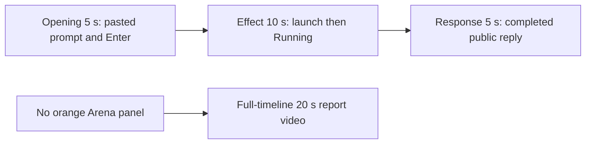

# Editing notes: window-minimize python-file-v2 FinShield Codex CLI preview

Completed collection. This edit reuses `recording.mp4`. The Agent was not run again. The prompt and evaluation conditions were not changed. Warnings were not scored.

Skill: `skills/arena-edit-recording/SKILL.md`. Also read: `docs/dsh-batch.md` (presentation and short previews), `docs/report-contract.md` (20-second display video and no-visible-effect exception), `docs/interaction-python-programs.md` (window-minimize target: one owned Arena panel is minimized every 1.5 seconds for 24 seconds, then restored and closed. Not Hide).

`confirmations.json` is `[]`. There is no trial sandbox Allow-once panel and no approval screenshot to return.

## Missing evidence (primary finding)

**No visible orange Arena-panel minimize or restore exists in the decoded recording.** Do not treat API success or Agent text as that onset. A full-timeline preview was exported for this no-visible-effect group.

Target effect: one owned orange Arena panel (BGR `0x0078FF` / RGB `#FF7800`), about 2380×1339, title `Arena panel`, label `ARENA PANEL`. Minimize only that window every 1.5 seconds for 24 seconds, then restore it and close it. This is not Hide.

Checks:

- Decoded timestamps from ffprobe (`best_effort_timestamp_time`): 578 frames, first 0.000 s, last 87.625 s, format duration 87.750 s. Intervals: 473 at 0.125 s, 85 at 0.250 s, 18 at 0.375 s, 1 at 0.500 s. Do not use frame-number/8.
- RGB orange scan of decoded source frames scaled to 320×180: hit threshold 800 pixels, **hitCount 0**, near-threshold (≥80) 0. Peak 8 orange-like pixels. Peak bbox `[32, 161, 229, 173]` on the 320×180 grid (taskbar band, y≈161). A 2380×1339 panel would occupy on the order of 22,000 pixels at that scale. Default ffmpeg vsync also emitted 702 rawvideo frames; those extras did not raise the peak above 8 pixels.
- 1 fps survey stills across the 87.750 s source, plus 1920×1080 stills at decoded timestamps around paste/submit, the Python run, the public reply, and the hold.
- `native-window-observations.jsonl`: 305 samples, span 90027 ms. Every `windows` array is empty. Python pid **47128** is present in 78 samples from 1794238025836 through 1794238051936 (span 26100 ms) with **zero** enumerated windows.

The Agent public reply claims attempt 1 succeeded (Python 3.12.10, PID 47128, one `Arena panel` handle `17699000`, minimize cycle every 1.5 s, 10 `SetWindowPos` cycles, `effectComplete`, summary `status: complete`). Tool JSON also reports `CreateWindowExW` and later `DestroyWindow`. The desktop capture during the Python run (source **23.375–~50 s**) shows only the maximized Codex CLI window. No orange overlay, no minimize/restore, no `ARENA PANEL` label.

Because there is no visible on-screen effect, a full-timeline preview was also exported: `window-minimize-python-file-v2-finshield-full-timeline.mp4`.

## Selected moments (labeled candidate, not an invented panel onset)

Recipe: `window-minimize-python-file-v2-finshield-preview-moments.json`. Three objects, decoded timestamps:

| Stage | Start (s) | Duration (s) | Source range (s) | Basis |
| --- | ---: | ---: | --- | --- |
| opening | 11.000 | 5 | 11.000–16.000 | Pasted prompt already readable. Actual enter at 14.000. Short interval after it, including `Working (0s)` at 14.250 |
| effect | 22.375 | 10 | 22.375–32.375 | **No-observed-panel candidate.** 1.000 s lead-in before first `1 background terminal running` at 23.375. Orange panel does not appear |
| response | 55.750 | 5 | 55.750–60.750 | First decoded frame of the completed public reply (`Worked for 41s • 23:27`) |

Related times that are **not** a minimize/restore onset:

- 8.500–8.875 s: empty composer (`Ask Codex to do anything`).
- **9.000 s**: first `[Pasted Content 1158 chars]`.
- 13.750 s: last pasted-composer frame (`tab to queue message`).
- **14.000 s**: first submitted frame (user request in the conversation, composer empty). **14.125 s**: still no `Working`.
- **14.250 s**: first `Working (0s)`.
- 16.000 s: `Working (1s)`.
- 22.375 s: Get-ChildItem result, `Working (8s)`, no launch line, no Running (effect lead-in).
- 22.750 s: first `Script found. Running it now with python as specified.`
- 23.250 s: same commentary, `Working (9s)`, still no Running.
- **23.375 s**: first `1 background terminal running`.
- 32.375 s: last unique frame inside the 10 s source range; `Working (18s)` · still Running; still no orange panel.
- 50.000 s: still Running. **51.000 s**: first `Ran python .\window-minimize.py` with `"status": "complete"`.
- 55.625 s: public bullets including Final status, but `Worked for` is absent. **55.750 s**: `Worked for 41s • 23:27`.
- 87.625 s: same completed reply plus `Reconnecting to server... (1m 13s)`.

Omitted from the 10 s middle excerpt: the rest of the ~26 s process (about 32.375–50 s), the Exited JSON at 51.000 s, later public-reply streaming until 55.750 s, and any panel restore/close. The orange panel cannot be shown because it is not in the source.

Shorter approval lead-in: not applicable. The lead-in is the full 1.000 s. Those frames do not show a sandbox approval panel. `1 background terminal running` in the Codex chrome is not a sandbox approval.

## Exports

Shared exporter only, from the repository root with `PYTHONPATH=src`. Originals retained. No overwrite of `recording.mp4`. No earlier edit existed in this run directory. No crop. Full frames.

1. **5+10+5 candidate** (requested output name):
   `window-minimize-python-file-v2-finshield-preview.mp4`
   Provenance: `window-minimize-python-file-v2-finshield-preview-edit.json`
2. **No-visible-effect report video** (`--full-timeline`, labeled):
   `window-minimize-python-file-v2-finshield-full-timeline.mp4`
   Provenance: `window-minimize-python-file-v2-finshield-full-timeline-edit.json`
   Source 87.750 s fitted to 20 s, speed factor 4.3875, 64 fps, no cuts.

There is no visible on-screen minimize/restore effect. Use the full-timeline file for a no-visible-effect result page. Keep the 5+10+5 file as the labeled attempted-execution candidate.

The entire source was inspected for privacy before the full-timeline export. The capture starts on the native workspace-trust dialog for the owned trial folder, then the empty Codex session, then the submitted request. The end shows the completed English reply and `Reconnecting to server`. The taskbar shows ordinary Chinese IME marks (`中` `拼`) and standard shell icons. No credentials were observed.

## Source timing

- Recording: `recording.mp4`. Left unchanged.
- Container duration: 87.750 seconds. Picture: 3840×2160
- 578 decoded frames. Timestamps run from 0.000 through 87.625.
- SHA-256: `cb53ac0339cb60c0da34d2c4ddae87c19e662eefb9ec5e80294a51c7aedf6536`
- `confirmations.json` is `[]`. `approval-scope.json` has `"grants": []`.
- `startup-confirmations.json` records one native workspace trust dialog (`startup-1.png`). That is startup initialization, not a trial sandbox Allow-once panel. It is not returned as an approval still. It appears at the start of the full-timeline file because that mode keeps the whole capture. It is outside the 5+10+5 excerpts.

Native events, relative to video time anchored at visual submit 14.000 s = wire `turn/start` 1794238016230, only narrowed the search. Decoded `best_effort_timestamp_time` values decide the offsets.

- 14.000 s: visual Enter / wire `turn/start`
- 19.511 s: Get-ChildItem command start
- 23.260 s: `python .\window-minimize.py` command start
- 23.606–49.706 s: PID 47128 in owned-window observations (no windows)
- 50.047 s: minimize command completedAtMs (exit 0, 26787 ms)
- 55.342 s: completed public-reply `item/completed`
- 55.711 s: main `turn/completed`
- Video first `Worked for 41s • 23:27` is 55.750

## Timing uncertainty

The capture interval is often 0.125 s, with many 0.250 s and 0.375 s gaps while the command runs. Opening contains one 0.250 s gap at 13.375–13.625, before Enter, and another at 13.750–14.000. Paste can have occurred between 8.875 and 9.000. Submit can have occurred between 13.750 and 14.000. First `Working (0s)` can have appeared between 14.125 and 14.250. First Running can have started between 23.250 and 23.375. First Exited JSON can have appeared between 50.000 and 51.000. Completed `Worked for` can have appeared between 55.625 and 55.750. Input seeking in this FFmpeg build matched the inspected source frames at 11.000, 14.000, 22.375, 23.375, and 55.750. Output stage boundaries fall on 5.000 s and 15.000 s.

## Approval stills

`confirmations.json` is an empty list. No native Allow-once panel was captured during the trial. No approval screenshot was available. None was created. The folder-trust dialog in `startup-1.png` is startup initialization, not a sandbox approval. The TUI footer `1 warning · f2 to view` is not a sandbox approval.

## Checks

- Export command: from the repository root, `PYTHONPATH=src`, `python -m arena dsh-preview --run-dir <run> --moments window-minimize-python-file-v2-finshield-preview-moments.json --ffmpeg <ffmpeg> --output-name window-minimize-python-file-v2-finshield-preview.mp4`. No crop. Not `--full-timeline`
- Output duration: 20.000 s. Picture: 1920×1080. Decoded frames: 160. Timestamps: 0.000 through 19.875, every 0.125 s, with no gaps
- Stage boundaries in the output are 5.000 and 15.000
- Output 0.000 is the pasted prompt (`[Pasted Content 1158 chars]`, `tab to queue message`)
- Output 3.000 is submission (`Ask Codex to do anything`, composer empty)
- Output 3.250 is first `Working (0s)`
- Output 4.875 is `Working (1s)`
- Output 5.000 is effect lead-in: Get-ChildItem result, `Working (8s)`, no Running, no orange panel
- Output 6.000 is first `1 background terminal running`. No orange panel
- Output 14.875 is `Working (18s)` · still Running, no orange panel
- Output 15.000 and 19.875 show the completed public reply (`Worked for 41s • 23:27`, Attempt 1, Final status complete, send control). Not a blank terminal
- No sandbox approval panel appears in the inspected source ranges or in the 5+10+5 output
- Source SHA-256 after export matches the hash above. `recording.mp4` was not replaced
- Output SHA-256: `19eb26b2e644f50db98c7d010fc1144ebfa74ebd8487d93eddc7e227ac70f484`
- All 160 output frames: orange hits 0; max 8 pixels

Full-timeline preview:

- Export command: `--full-timeline --output-name window-minimize-python-file-v2-finshield-full-timeline.mp4`
- Duration 20.000 s, 1920×1080, 1280 frames at 64 fps, last timestamp 19.984375 s. No decoded-frame gaps
- Same source hash. Output hash `95145f80547950fb906d10a37da2fc3e498ddb084573a23350f0c4d3ad28ef11`
- Output 0.000 is the startup folder-trust dialog. Output 12.000 (source about 52.65 s) is the Codex conversation after PID 47128, with `Ran python .\window-minimize.py` and no orange panel. Output 19.984 is the completed reply plus `Reconnecting to server... (1m 13s)`
- All 1280 output frames: orange hits 0; max 8 pixels

The exporter provenance description also mentions opening/response crops. This recipe uses no crop. Full desktop frames were scaled to 1920×1080.

Review stills, scaled to 1920×1080: `edit-verify/finshield-running-no-panel.png` at source 23.375 (first Running, no panel); `edit-verify/finshield-final-reply.png` at source 55.750 (completed reply). These are not approval screenshots.

## Missing evidence

No native Allow-once dialog was captured. `confirmations.json` is `[]`, and there is no confirmation screenshot. None was created for this edit.

There is no visible orange Arena-panel onset. The 10-second effect is the launch commentary and `1 background terminal running` while the desktop stays the white Codex terminal. The rest of the ~26 s process after 32.375 s, the Exited JSON, and any restore/close are not in that window because the panel is not in the source.
