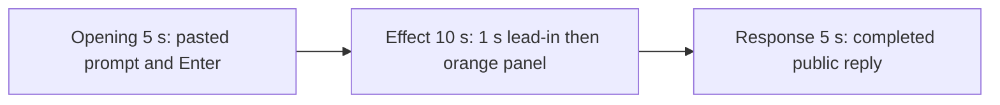

# Editing notes: window-resize python-file-v2 Claude CLI native preview

Collection was already complete. This edit reuses `recording.mp4`. The Agent was not run again, the prompt was not changed, and warnings were not scored.

Output name: `native-preview.mp4`. No earlier preview was present. `recording.mp4` was not replaced.

Skill files read: `skills/arena-edit-recording/SKILL.md` and the Presentation and short previews section of `docs/dsh-batch.md`.

## Source

- Recording: `recording.mp4` in this run directory
- Container duration: 107.875 seconds. Last decoded frame 107.750 seconds. Picture: 3840x2160
- 650 decoded frames. `best_effort_timestamp_time` runs from 0.000 through 107.750
- Intervals: 485 of 0.125 s, 123 of 0.250 s, 34 of 0.375 s, 6 of 0.500 s, and 1 of 0.625 s (75.375→76.000). Offsets use decoded timestamps, not frame-number/8
- SHA-256: `b510aa6aa2aa8a351d2d526a28e609b9ee8618c58fbdc85fde209491287e5aa3`
- Maximized Claude CLI in Windows Terminal. Auto mode. PowerShell route. `claude-transcript-observation.json`: `powershellUsed` true, `bashUsed` false, `gitBashStartupFailure` false
- `confirmations.json` is `[]`. There is no numbered approval
- Pillow, NumPy, and OpenCV were not in the repository venv. Every source frame was decoded with installed FFmpeg to 320×180 RGB24 (`fps_mode=passthrough`) and scanned in the standard library, mapped 1:1 to ffprobe timestamps. Adjacent stills used `select=eq(n,INDEX)` or `-ss` after `-i` at known timestamps. A 1 fps contact sheet was used only to search. RGB dumps were not zip-aligned when counts differed; this passthrough dump matched 650 frames to 650 timestamps

Native events and the session jsonl were used only to narrow the search. Offsets below are decoded source frames. OCR was not used. `agent-output.txt`, `CreateWindowExW`, `nowVisible`, `effectComplete`, and resize JSON are not this desktop measurement.

A leftover Camera pin stays on the taskbar in inspected frames. No Camera application window covers the desktop. No Cursor IDE window is on the recorded screen. Those icons are leftover desktop chrome, not the Arena panel.

`native-window-observations.jsonl` has 306 rows. Every `windows` array is empty because the Arena panel process is not in the recovery Job. That file does not disprove a visible orange panel. This recording was judged from frames, independently of a Codex CLI native trial on this machine.

## Observed onset

The first visible orange Arena panel is source **45.750 s**. That first visible frame is already **large**. Title `Arena panel`, label `ARENA PANEL`. The script creates the small window and immediately resizes it to large. The small-create step is not on a decoded frame.

Adjacent decoded frames:

- **44.750 s**: maximized Claude CLI, no Arena panel. `$ python .\window-resize.py` running · `8s`. Auto mode. No approval panel
- **45.500 s**: still Claude CLI only. Same named command · `9s`. No orange panel
- There is no decoded frame at 45.625 s (0.250 s gap from 45.500 to 45.750)
- **45.750 s**: large orange `Arena panel`, label `ARENA PANEL`. This is the first orange frame
- **45.875 s**: still large

Orange-pixel scan of every decoded frame, scaled to 320×180 and mapped 1:1 to ffprobe timestamps (`R>=200`, `80<=G<=160`, `B<=60`, `R>=G+60`, `R>=B+140`, hit threshold 800): 650 frames, **hitCount 161**, peak 52754 pixels. First hit **45.750 s** (large), last hit **71.500 s** (small). `belowThresholdCount` 0. Exact `#FF7800` appears on large frames (max 9 pixels at this scale after 420p encode).

Size cycle (about 1.5 s each):

- 45.750 large (onset)
- 47.250 first shrink to small
- 48.750 large
- 50.250 small
- 51.750 large
- 53.375 small
- 54.875 large
- 56.250 small
- 57.875 large
- 59.375 small
- 60.875 large
- 62.375 small
- 63.875 large
- 65.375 small
- 67.000 large
- 68.500 small
- 71.750 first decoded frame without the panel after that close

That is 16 visible resize steps, then the already-small panel holds about 2 s and closes. A named PowerShell line `$ python .\window-resize.py` is first visible at **35.750 s**. That line is not the panel.

## Selection

No crop. Full frames. Original speed.

| Stage | Start (s) | Duration (s) | Source range (s) | Basis |
| --- | ---: | ---: | --- | --- |
| opening | 11.500 | 5 | 11.500–16.500 | Unsent paste, then Enter, then a short interval after it |
| effect | 44.750 | 10 | 44.750–54.750 | 1.000 s before the first panel frame, then grow/shrink at original speed |
| response | 74.875 | 5 | 74.875–79.875 | First decoded frame of the completed public reply |

Opening. Empty composer at **9.375 s**. **9.500 s** is the first `[Pasted text #1 +22 lines]` frame. That paste stays through **15.250 s**. **15.500 s** is the first submitted frame: composer clear, expanded request readable, footer `Caramelizing...`. Paste onset to Enter is 6.000 s, so one 5 s window cannot include both the first paste frame and the Enter frame. This window starts at **11.500 s**, while the paste is still unsent, and includes Enter at 15.500 plus thinking through 16.500 (`Hatching... (1s · thinking)` at 16.375). `trim=duration=5` is end-exclusive of 16.500. The workspace trust dialog is at source 0.000 s and is outside this excerpt. Empty composer is on screen by 9.125 s.

Effect. Recipe start is **44.750**, exactly 1.000 s before 45.750, and that timestamp exists. **44.750** through **45.500** still have no Arena panel and no approval dialog. The onset at 45.750 is inside the segment (output 6.000). Later frames in this 10 s window show the first shrink, the next enlarge, and further size changes through the small frame at 54.625. `trim=duration=10` is end-exclusive of 54.750. 54.750 exists and is still small; 54.875 is the next large and is not included.

Response. At **74.625 s** the footer is still `Hatching... (59s · thought for 1s)` with `esc to interrupt`. Visible text is tool narration, not the formatted reply. At **74.875 s** the turn is complete: `Cogitated for 59s · done 2:15`, an empty composer, and `auto mode on` without the interrupt hint. Visible text matches `agent-output.txt` (`Final status: Complete (success)`, PID 44004, 844×475 / 3808×2112, 16 resize steps). That completed view holds through 79.750 and through the raw recording end at 107.750 s.

## Omitted effect and closure

The 10 s effect window includes the 1.000 s CLI lead-in and about 8.875 s of grow/shrink (45.750 through 54.625). It omits:

- Remaining size cycles from 54.750 through 71.500
- Close at 71.750, when the panel is gone
- Later narration before the public reply

The first paste frame at 9.500 is omitted from the opening. The Attempts / tool-narration text before 74.875 is omitted from the response. The full prompt is in `prompt.txt`. The full reply is in `agent-output.txt` and `final-screen.png`.

No lead-in was shortened. No numbered approval panel is in the selected ranges.

The first visible effect is already large. A later shrink or enlarge was not chosen as onset.

## Timing uncertainty

The usual capture interval is 0.125 s. Panel paint can have started between 45.500 and 45.750, including a missed small-create. Enter can have occurred between 15.250 and 15.500. The completion footer can have appeared between 74.625 and 74.875. Paste can have appeared between 9.375 and 9.500. Close can have occurred between 71.500 and 71.750. Do not use frame-number/8. Output stage boundaries fall on 5.000 s and 15.000 s after 8 fps wall-clock normalization.

Inside the selected windows:

- Opening: several 0.250 s gaps on unsent paste. **15.250→15.500** (0.250) ends at Enter. 15.500 exists and is the submitted command
- Effect: **45.500→45.750** (0.250) is the onset gap. Later 0.250 s steps sit inside visible large or small intervals, not at a substituted peak
- Response: **75.375→76.000** (0.625) sits after the completed reply is already on screen. 74.875 and 79.875 exist. Last included source frame in this window is 79.750

None of those gaps hides paste, Enter, panel onset, or the completed reply.

## Approval stills

`confirmations.json` is empty. There is no numbered approval and no approval screenshot to return.

`startup-1.png` and `startup-confirmations.json` record the workspace trust dialog before the prompt. That dialog is visible at source 0.000 s and is outside this edit. It is not a numbered trial approval.

## Checks

- Export command: from the repository root, `PYTHONPATH=src`, `.venv` Python `-m arena dsh-preview --run-dir artifacts/runs/claude-20261110T181346-6e8b2c80 --moments artifacts/runs/claude-20261110T181346-6e8b2c80/native-preview-moments.json --ffmpeg installed FFmpeg --output-name native-preview.mp4`. No crop. Not `--full-timeline`
- Stills, scaled to 1920x1080 with `-ss` after `-i`: `native-effect.png` at source 45.750 (first large `Arena panel`), SHA-256 `f95b9fd55958c31956bbb647ae2f4ba2a045e30d240fb9b538cd873d8e15e73d`; `native-final.png` at source 74.875 (first completed reply), SHA-256 `3f0f59c3085af59317e7f6866c13c22034526e2752733d71ac8cd3b45ca67311`
- Output: `native-preview.mp4`. Duration: 20.000 s. Picture: 1920x1080. Decoded frames: 160. Timestamps: 0.000 through 19.875, every 0.125 s, with no gaps
- Stage boundaries in the output are 5.000 and 15.000
- Output 0.000 shows `[Pasted text #1 +22 lines]`. Output 3.875 is still unsent paste. Output 4.000 is the Enter frame (expanded prompt, `Caramelizing...`). Output 4.875 is `Hatching... (1s · thinking)`
- Output 5.000 and 5.875 are Claude CLI with `$ python .\window-resize.py` and no Arena panel. Output 6.000 is the large orange onset. Output 7.500 is the first shrink to small. Output 8.000 is still small. Output 9.000 is large again. Output 14.875 is small
- Output 15.000 and 19.875 show the completed public reply (`Final status: Complete (success)`, `Cogitated for 59s · done 2:15`, empty composer, `auto mode on` without `esc to interrupt`)
- Output orange scan: 160 frames, 72 panel hits, first 6.000 large, last 14.875 small, max 52757 pixels. No orange in opening or response
- No sandbox approval panel appears in the inspected source ranges or in the output
- Source SHA-256 after export matches the hash above. `recording.mp4` was not replaced
- Output SHA-256: `fb9eb67727479e3a58984cc8155ee18eb55adf6fd442e70b908fda5a5db581ad`
- Provenance: `native-preview-edit.json`

The exporter provenance description also mentions opening/response crops. This recipe uses no crop. Full desktop frames were scaled to 1920×1080.

## Missing evidence

There is no numbered approval capture. `confirmations.json` is empty, which matches auto mode.

The paste chip does not show the command text. The expanded command is visible after Enter. The 5 s opening omits the first paste frame at 9.500. The 5 s reply window shows the closing report and footer; earlier tool narration is scrolled above. The full prompt is in `prompt.txt`. The full reply is in `agent-output.txt`.

The 10 s effect omits the last ~16.75 s of grow/shrink plus the close at 71.750.

## Inspection artifacts (not trial originals)

`artifacts/verification/claude-window-resize-native-6e8b2c80/`
