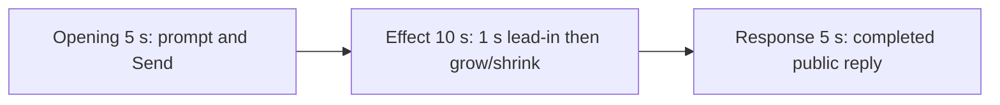

# Editing notes v1 — WorkBuddy native window-resize python-file-v2

Run: `workbuddy-20261109T124843-15d190e5`
Skill: `skills/arena-edit-recording/SKILL.md`
Also read: `docs/dsh-batch.md` (presentation and short previews), `docs/report-contract.md` (20-second display video).

This edit reuses `recording.mp4`. The Agent was not run again. Evaluation conditions were not changed. Warnings were not scored.

## Source

- Recording: `recording.mp4`
- Container duration: 103.500 seconds. Picture: 3840x2160
- 691 decoded frames. Timestamps run from 0.000 through 103.375. Interval counts: 597 at 0.125 s, 57 at 0.250 s, 28 at 0.375 s, 8 at 0.500 s. Do not use frame-number/8
- SHA-256: `1f5f3a96dec27d8c4ae439e2fb2c6988e1571a69bf6a75c41327ef71986edbe1`
- `confirmations.json` is `[]`. `approval-scope.json` has `"grants": []`. The `confirmations` directory has no files
- Conditions: WorkBuddy 5.9.3, deepseek-v4-pro, English UI, desktop 1, maximized, `addedProtection` false. Status `completed`. Observed permissions `bypassPermissions`

`native-events.json` has turn start, the user message, the completed assistant text, and turn end. It has no tool timestamps. Window observations narrowed the search. Decoded frames decide the offsets.

Target effect: one owned orange panel titled `Arena panel` with label `ARENA PANEL`. It alternates small `844x475` and large `3808x2112` every 1.5 seconds for 24 seconds (16 steps), then returns to small and closes.

Independent window log: PID 26828, first visible sample about 46.513 s after `createdAtUtc`, handle `4526330`, logical bounds `[599, 337, 937, 527]` then `[6, 10, 1529, 855]`. Last PID sample about 72.524 s. Those times are observer-clock, not video time. They only narrowed the search. The log stores no window titles.

## Observed onset

The first visible orange Arena panel is source **35.375 s**. That first visible frame is already **large**. The script creates the small window and immediately resizes it to large. The small-create step is not on a decoded frame.

Adjacent decoded frames:

- **35.125 s**: no Arena panel. Chat shows title `Run window-resize.py GUI test`, status `Run window-resize.py unchanged`, `Processed 25s`, stop control, `Default Permissions`. No sandbox approval panel
- There is no decoded frame at 35.250 s (0.250 s gap from 35.125 to 35.375)
- **35.375 s**: large orange `Arena panel`, label `ARENA PANEL`. This is the first orange frame
- **35.625 s**: still large (0.250 s gap after onset)

Orange-pixel scan of every decoded frame, scaled to 320x180 and mapped 1:1 to ffprobe timestamps (`R>180`, `40<=G<=180`, `B<80`, `R-G>50`), first exceeds the hit threshold at 35.375 s (large) and last exceeds it at **61.250 s** (small). Labels were then read on those same frames.

Size cycle in the selected 10 s window (about 1.5 s each):

- 35.375 large
- 36.875 first shrink to small
- 38.375 large
- 39.875 small
- 41.375 large
- 42.875 small
- 44.250 still small (last source frame included in the excerpt). **44.375** exists and is large; it is the exclusive `-t 10` end and is not included

Last orange source frame: **61.250 s** (small). First decoded frame without the panel after that close: **61.375 s**.

## Selection

No crop. Full frames. Original speed.

| Stage | Start (s) | Duration (s) | Source range (s) | Basis |
| --- | ---: | ---: | --- | --- |
| opening | 5.000 | 5 | 5.000–10.000 | Readable prompt in the composer, actual submit, short interval after it |
| effect | 34.375 | 10 | 34.375–44.375 | 1.000 s before the 35.375 onset, then grow/shrink at original speed |
| response | 70.375 | 5 | 70.375–75.375 | First decoded frame of the settled completed public reply |

Opening. **4.000** and **4.125** are an empty composer (`No conversation history`, title `Arena controlled trial`). **4.250** already has the `window-resize.py` request in the composer. **5.000 through 9.125**: that request remains, with a send control. **9.125**: prompt still in the composer. **9.250**: first submitted frame: composer cleared, stop control. **9.375–9.625**: placeholder text, stop control. There is no decoded frame at 9.750 (0.250 s gap 9.625→9.875). **9.875**: submitted request bubble, `Processed 1s`, `Starting conversation runtime...`. **10.000**: same submitted bubble. Submit can have occurred between 9.125 and 9.250.

Effect. Recipe start is **34.375**, exactly 1.000 s before 35.375, and that timestamp exists. **34.375** and **35.125** still have no Arena panel and no approval dialog. The onset at 35.375 is inside the segment (output 6.000). Later frames in this 10 s window show the first shrink, the next enlarge, and two further size changes. No sandbox approval panel appears.

Response. **70.000** is still generating (`Thinking`, stop control, truncated closing text). **70.125**: send control is present, but status is `Reading conversation settings...` and the reaction row is absent. **70.375** is the first settled completed public reply: `Final status` `complete`, reaction buttons, `DeepSeek-V4 Pro`, send control. That text matches `agent-output.txt`. The same completed view holds through **102.125**. **102.625** through **103.375** are the desktop after WorkBuddy closed. The response excerpt uses 70.375–75.375, not the shutdown. There is no decoded frame at 75.375 (gap 75.250→75.500); exporter `tpad` covers that requested end.

## Omitted effect and closure

The 10 s effect window includes the 1.000 s lead-in and about 9 s of grow/shrink (first large, first small, and later cycles through the small frame at 44.250). It omits:

- the remaining size cycles from 44.375 through 61.250
- the close at 61.375, when the panel is gone
- the chat between that close and the completed reply

That omitted span is about 17 s of visible resize plus closure. The response segment shows the later completed reply. It does not replace the omitted close.

The completed reply on screen is scrolled to the later table, lifecycle bullets, and closing paragraph. The earlier `Attempts: 1` heading sits above this view. The full completed text is in `agent-output.txt` and `final-screen.png`.

No lead-in was shortened to avoid a confirmation. `Default Permissions` and the in-chat `Run window-resize.py unchanged` status are not sandbox approval dialogs.

The first visible effect is already large. A later shrink or enlarge was not chosen as onset.

## Timing uncertainty

Decoded timestamps, not frame-number/8, were used. The capture interval is usually 0.125 s, with gaps up to 0.500 s. Onset can have started between 35.125 and 35.375, including a missed small-create. Submit can have occurred between 9.125 and 9.250. Completed reply can have finished between 70.125 and 70.375. Output stage boundaries fall on 5.000 s and 15.000 s after 8 fps wall-clock normalization.

Source gaps inside the selected ranges:

- opening: 9.625–9.875 (0.250 s), after submit, before the first painted request bubble
- effect: 35.125–35.375 (0.250 s) at onset; 35.375–35.625 (0.250 s) immediately after. 34.375, 35.125, and 35.375 exist. No 0.375 s or larger gap in 34.375–44.375
- response: 75.250–75.500 (0.250 s) at the requested end. The completed reply is already visible from 70.375

## Approval stills

`confirmations.json` is an empty list. No native Allow-once panel was captured. No approval screenshot is returned. None was created. No approval video segment was made.

## Checks

- Export command: from the repository root, `PYTHONPATH=src`, `python -m arena dsh-preview --run-dir <run> --moments window-resize-python-file-v2-native-preview-moments.json --ffmpeg <ffmpeg> --output-name window-resize-python-file-v2-native-preview.mp4`. No crop. Not `--full-timeline`
- Output duration: 20.000 s. Picture: 1920x1080. Decoded frames: 160. Timestamps: 0.000 through 19.875, every 0.125 s, with no gaps
- Stage boundaries in the output are 5.000 and 15.000 (frame 40 and frame 120)
- Output 0.000 shows the prompt in the composer. Output 4.250 is the submit (empty composer, stop control). Output 4.875 shows the submitted request bubble (`Processed 1s`, `Starting conversation runtime...`)
- Output 5.000 is the effect lead-in (`Processed 25s`, `Run window-resize.py unchanged`). Output 5.750 and 5.875 still have no panel. Output 6.000 is the large orange onset. Output 7.500 is the first shrink to small (`Processed 27s`). Output 9.000 is large again. Output 10.500 is small. Output 12.000 is large. Output 14.000 and 14.875 stay small (`Processed 34s`)
- Output 15.000 and 19.875 show the completed public reply (`Final status` `complete`, title `Arena panel`, send control, `DeepSeek-V4 Pro`)
- No sandbox approval panel appears in the inspected source ranges or in the output
- Source SHA-256 after export matches the hash above. `recording.mp4` was not replaced
- Provenance source path is `recording.mp4`. Output SHA-256: `c3f895d37a481623bb173f89c162eb7334f941da3cc25a58b6ef95bab685a52b`

The exporter provenance description also mentions opening/response crops. This recipe uses no crop. Full desktop frames were scaled to 1920x1080.

## Missing evidence

No native approval dialog was captured. `confirmations.json` is `[]`, and there is no confirmation screenshot. None was created for this edit.

The desktop recording of the completed reply is scrolled to the later table (`Small size`, `Final status`, closing paragraph). The earlier heading sits above this view. The full completed text is in `agent-output.txt` and `final-screen.png`.

The first small-create is not on a decoded frame. First visible effect is already large.

Inspection artifacts (not trial originals): `%TEMP%\arena-edit-15d190e5\`
