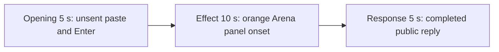

# Editing notes: window-shake python-file-v2 Claude CLI native preview

Collection was already complete. This edit reuses `recording.mp4`. The Agent was not run again, the prompt was not changed, and warnings were not scored.

Output name: `native-preview.mp4`. No earlier preview was present. `recording.mp4` was not replaced.

Skill files read: `skills/arena-edit-recording/SKILL.md` and the Presentation and short previews section of `docs/dsh-batch.md`.

## Source

- Recording: `recording.mp4` in this run directory
- Container duration: 109.500 seconds. Last decoded frame 109.375 seconds. Picture: 3840x2160
- 828 decoded frames. `best_effort_timestamp_time` runs from 0.000 through 109.375
- Intervals: 785 of 0.125 s, 38 of 0.250 s, 2 of 0.375 s, and 2 of 0.500 s. Offsets use decoded timestamps, not frame-number/8
- SHA-256: `36d31e0b3ec469aa5eff3df612a41ec7eab6c8511ea05ee918d69e30caadd79e`
- Maximized Claude CLI in Windows Terminal. Auto mode. PowerShell route. `claude-transcript-observation.json`: `powershellUsed` true, `bashUsed` false, `gitBashStartupFailure` false
- `confirmations.json` is `[]`. There is no numbered trial sandbox approval
- Pillow was not installed. A 1 fps still set at integer seconds, plus adjacent stills with `select=eq(n,INDEX)` mapped 1:1 to ffprobe frame indices, located the orange panel. RGB was read per still or per 1 fps stream. This was not a zip-aligned raw RGB dump against the full PTS list

Native events, `agent-output.txt`, and the session jsonl were used only to narrow the search. Offsets below are decoded source frames. OCR was not used. `CreateWindowExW`, `nowVisible`, `effectComplete`, move JSON, and the public reply are not this desktop measurement.

A leftover Camera taskbar button is visible throughout the recording. It is not the case effect. No leftover Cursor window covers the recorded Claude CLI desktop.

`native-window-observations.jsonl` has 386 rows. Every `windows` array is empty because the Arena panel process is not in the recovery Job. That file does not disprove a visible desktop panel.

## Observed onset

A visible orange Arena panel exists. Title `Arena panel`. Label `ARENA PANEL`. About 1612×907 at 3840×2160. No separate taskbar button. It jumps the four primary-screen corners, then sits at center, then closes.

The first visible panel frame is source **45.875 s** (ffprobe index 350). 1 fps orange scan at 320×180, client area above the taskbar, threshold 800 pixels: 26 hits from 46 s through 71 s, peak 8835 pixels, bbox moving among the four corners then center. A 1612×907 panel is on the order of 10,000 pixels at that scale.

Adjacent decoded frames:

- **44.875 s**: maximized Claude CLI, no Arena panel. `$ python .\window-shake.py` under `Finding *.py`. `Pondering... (29s)`. Auto mode. No approval panel
- **45.625 s**: still Claude CLI only. Same command. `Finding *.py · 25s`. No orange panel
- **45.875 s**: first panel frame. Orange panel, top-left, title `Arena panel`, label `ARENA PANEL`. 8830 orange pixels at 320×180. First visible effect
- **46.125 s**: same top-left panel
- **47.000 s** (1 fps): panel at bottom-right
- **70.000 s** and **71.000 s** (1 fps): panel at center, 8835 orange pixels
- **72.000 s** (1 fps): Claude CLI restored. No Arena panel

The named PowerShell start of `$ python .\window-shake.py` is first visible at **23 s** on the 1 fps stills. That line is not the desktop measurement. The orange panel at 45.875 is the effect. A Codex CLI native sibling on this machine had no visible orange panel; this recording was judged independently from frames and does contain the panel.

## Selection

No crop. Full frames. Original speed.

| Stage | Start (s) | Duration (s) | Source range (s) | Basis |
| --- | ---: | ---: | --- | --- |
| opening | 12.625 | 5 | 12.625–17.625 | Unsent paste, then Enter, then a short interval after it |
| effect | 44.875 | 10 | 44.875–54.875 | 1.000 s before the first panel frame, then corner jumps |
| response | 76.375 | 5 | 76.375–81.375 | First decoded frame of the completed public reply |

Opening. Empty composer at **9.750 s**. **9.875 s** is the first `[Pasted text #1 +22 lines]` frame. That paste stays through **15.500 s**. **15.625 s** is the first submitted frame: the composer is clear, the expanded prompt is readable (`window-shake.py`, Reply in English), and the footer is `Unraveling...`. Paste onset to Enter is 5.750 s, so one 5 s window cannot include both the first paste frame and a short interval after Enter. This window starts at **12.625 s**, while the paste is still unsent, and includes Enter at 15.625 plus thinking through 17.500 (`Pondering... (2s · thinking)`). `trim=duration=5` is end-exclusive of 17.625. The workspace trust dialog is at source 0.000 s and is still on screen at 8.000 s (`Yes, I trust this folder` selected). **9.000 s** is the empty composer. Trust is outside this excerpt.

Effect. Lead-in is the full 1.000 s, from 44.875 through 45.625. Those frames show `$ python .\window-shake.py` running on a white Claude CLI. They do not show an approval panel. Panel at 45.875 is inside the segment (output 6.000). Later frames in this 10 s window stay on the jumping orange panel through 54.750. `trim=duration=10` is end-exclusive of 54.875. There is no decoded frame at 54.875; 54.750 is the last included source frame.

Response. At **76.250 s** the footer is still `Pondering... (1m 1s)` with `esc to interrupt`. Visible text is tool narration, not the formatted reply. At **76.375 s** the turn is complete: `Baked for 1m 1s · done 2:09`, an empty composer, and `auto mode on` without the interrupt hint. Visible text matches `agent-output.txt` (`Python 3.12.10`, panel 1612×907, `effectComplete: moves=30`, `completed successfully`). That completed view holds through 81.250 and through the raw recording end at 109.375 s.

## Omitted effect and closure

The 10 s effect window includes the 1.000 s CLI lead-in and about 8.875 s of the jumping panel (45.875 through 54.750). It omits:

- Remaining corner jumps from 54.875 through about 69 s
- Center rest at 70–71 s
- Close by 72 s (`Pondering... (56s)`, no panel)

The first paste frame at 9.875 is omitted from the opening. The Attempts / tool-narration text before 76.375 is omitted from the response. The full prompt is in `prompt.txt`. The full reply is in `agent-output.txt` and `final-screen.png`.

No lead-in was shortened. No numbered approval panel is in the selected ranges.

## Timing uncertainty

The usual capture interval is 0.125 s. The panel can have painted between 45.625 and 45.875. Enter can have occurred between 15.500 and 15.625. The completion footer can have appeared between 76.250 and 76.375. Paste can have appeared between 9.750 and 9.875. Trust dismissal can have occurred between 8.000 and 9.000. Close can have occurred between 71.000 and 72.000 on the 1 fps grid.

Inside the selected windows:

- Opening 12.625–17.625 includes the 0.250 s gap 14.875→15.125, before Enter
- Effect 44.875–54.875 includes the 0.250 s onset gap 45.625→45.875, plus further 0.250 s gaps while the panel jumps
- Response 76.375–81.375 includes 0.250 s gaps at 77.500→77.750 and 77.750→78.000. The completed reply is already on screen

## Approval stills

`confirmations.json` is an empty list. No trial sandbox approval screenshot was created or returned.

`startup-confirmations.json` has one workspace **Accessing workspace / Yes, I trust this folder** dialog, original still `startup-1.png`, actor automation. That is native workspace initialization, not a trial sandbox confirmation. It is visible at the start of the raw recording. It is not in the 5+10+5 opening (opening starts at 12.625, after the empty composer at 9.000).

## Checks

- Export command: from the repository root, `PYTHONPATH=src`, `python -m arena dsh-preview --run-dir <this run directory> --moments native-preview-moments.json --ffmpeg <installed FFmpeg> --output-name native-preview.mp4`. No crop. Not `--full-timeline`
- Output duration: 20.000 s. Picture: 1920x1080. Decoded frames: 160. Timestamps: 0.000 through 19.875, every 0.125 s, with no gaps
- Stage boundaries in the output are 5.000 and 15.000
- Output 0.000 shows `[Pasted text #1 +22 lines]`. Output 2.875 is still that unsent paste. Output 3.000 is the submit (expanded prompt, `Unraveling...`). Output 4.875 is `Pondering... (2s · thinking)`
- Output 5.000 has no Arena panel (`$ python .\window-shake.py`, `Pondering... (29s)`). Output 6.000 is the first orange panel. Output 14.875 still shows the jumping panel (bottom-left)
- Output 15.000 and 19.875 show the completed public reply (`Baked for 1m 1s · done 2:09`)
- Output 1 fps orange scan: 20 frames, leftover 0, hits at output 6–14 s, max 8837 pixels. No orange hit in opening or response
- No sandbox approval panel appears in the inspected source ranges or in the output
- Source SHA-256 after export matches the hash above. `recording.mp4` was not replaced
- Provenance: `native-preview-edit.json`. Output SHA-256: `59ef62ae763c38316d23f07b9c7a418b673167ff6e2502c44f3012aa02167307`
- Review stills, 1920×1080, `select=eq(n,INDEX)`: `native-effect.png` at source 45.875 (index 350, first panel); `native-final.png` at source 76.375 (index 568, completed reply)

## Missing evidence

No native trial sandbox approval dialog was captured. `confirmations.json` is `[]`, and there is no confirmation screenshot for a trial grant. None was created for this edit.

The 10 s effect excerpt does not include the center rest or the panel close. Those remain in `recording.mp4`.
