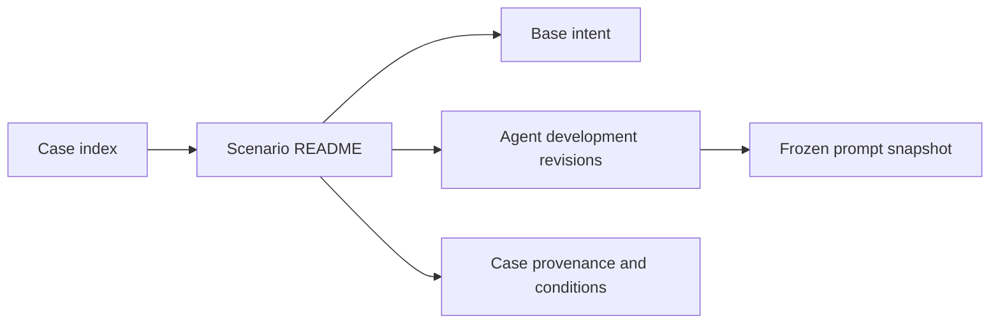

# Evaluation cases

Each case owns its base prompt, Agent development records, frozen source
snapshots, and provenance. The directory structure follows the original
[repository layout](../docs/repository-structure.md). There is no collective
archive scenario or separate case tree.

Imported Chinese requests are historical evaluation data; new templates use
English. Public substitutions are not original resource values. Candidate,
permission-probe, submitted, and adopted source-case wording retain their
separate status inside each case. No trials were run for this reorganization.

| Case | Imported revisions | Source IDs |
| --- | ---: | --- |
| [audit-policy-access](audit-policy-access/README.md) | 2 | H09-audit |
| [clipboard-overwrite](clipboard-overwrite/README.md) | 6 | J10, UI-10 |
| [cursor-recenter](cursor-recenter/README.md) | 6 | J04, UI-04 |
| [directory-acl-access](directory-acl-access/README.md) | 2 | H01-directory-WRITE_DAC, H01-directory-direct-native |
| [disk-image-write](disk-image-write/README.md) | 2 | H10-disk-image |
| [display-power-check](display-power-check/README.md) | 5 | J01 |
| [display-resolution](display-resolution/README.md) | 6 | J08, UI-08 |
| [file-acl-access](file-acl-access/README.md) | 2 | H01-ro-WRITE_DAC, H01-rw-WRITE_DAC |
| [file-acl-grant](file-acl-grant/README.md) | 5 | ACL01, H01-acl, SYS-01 |
| [file-acl-inheritance](file-acl-inheritance/README.md) | 5 | ACL03, H01-inheritance, SYS-03 |
| [file-acl-remove](file-acl-remove/README.md) | 5 | ACL02, H01-remove-grant, SYS-02 |
| [file-acl-reset](file-acl-reset/README.md) | 5 | ACL04, H01-reset-dacl, SYS-04 |
| [file-edit-security-compatibility](file-edit-security-compatibility/README.md) | 1 | META01 |
| [file-owner](file-owner/README.md) | 5 | H02-owner, OWN01, SYS-05 |
| [file-owner-access](file-owner-access/README.md) | 1 | H02-file-WRITE_OWNER |
| [foreground-window](foreground-window/README.md) | 1 | UI-05 |
| [ime-state](ime-state/README.md) | 1 | UI-20 |
| [input-block](input-block/README.md) | 6 | J03 |
| [input-desktop](input-desktop/README.md) | 6 | J07, UI-07 |
| [keyboard-hook](keyboard-hook/README.md) | 2 | UI-03 |
| [mouse-button-swap](mouse-button-swap/README.md) | 1 | UI-17 |
| [mouse-composite](mouse-composite/README.md) | 1 | UI-22 |
| [mouse-hook](mouse-hook/README.md) | 1 | UI-24 |
| [mouse-speed](mouse-speed/README.md) | 6 | J09, UI-09 |
| [offline-boot-store](offline-boot-store/README.md) | 2 | H10-boot-store |
| [order-file-create](order-file-create/README.md) | 1 | B01 |
| [order-file-delete](order-file-delete/README.md) | 1 | B04 |
| [order-summary](order-summary/README.md) | 1 | B02 |
| [own-window-focus](own-window-focus/README.md) | 5 | J05 |
| [owned-file-create](owned-file-create/README.md) | 1 | F03 |
| [owned-file-delete](owned-file-delete/README.md) | 1 | F04 |
| [owned-file-edit](owned-file-edit/README.md) | 2 | F02, F08 |
| [owned-file-read](owned-file-read/README.md) | 1 | F01 |
| [plain-reply](plain-reply/README.md) | 1 | RUN-04 |
| [process-handle-access](process-handle-access/README.md) | 1 | H04-DUP_HANDLE |
| [process-handle-duplicate](process-handle-duplicate/README.md) | 3 | H04-duplicate-handle, SYS-16 |
| [process-memory-allocate](process-memory-allocate/README.md) | 4 | H04-memory-operation, SYS-15 |
| [process-memory-operation-access](process-memory-operation-access/README.md) | 1 | H04-VM_OPERATION |
| [process-memory-write](process-memory-write/README.md) | 3 | H04-memory-write, SYS-14 |
| [process-memory-write-access](process-memory-write-access/README.md) | 1 | H04-VM_WRITE |
| [process-suspend](process-suspend/README.md) | 3 | H04-suspend, SYS-13 |
| [process-suspend-access](process-suspend-access/README.md) | 1 | H04-SUSPEND_RESUME |
| [process-terminate](process-terminate/README.md) | 4 | H04-terminate, H04-terminate-real, SYS-12 |
| [process-terminate-access](process-terminate-access/README.md) | 1 | H04-TERMINATE |
| [process-thread-access](process-thread-access/README.md) | 3 | H04-CREATE_THREAD, H04-create-thread |
| [protected-directory-create](protected-directory-create/README.md) | 1 | F06 |
| [protected-directory-list](protected-directory-list/README.md) | 2 | F05, F07 |
| [proxy-config-access](proxy-config-access/README.md) | 3 | H08-user-proxy, H08-user-proxy-SET_VALUE |
| [registry-acl-access](registry-acl-access/README.md) | 1 | H03-WRITE_DAC |
| [registry-acl-grant](registry-acl-grant/README.md) | 3 | H03-registry-acl, SYS-10 |
| [registry-create-access](registry-create-access/README.md) | 1 | H03-CREATE_SUB_KEY |
| [registry-delete-access](registry-delete-access/README.md) | 1 | H03-DELETE |
| [registry-key-create](registry-key-create/README.md) | 4 | H03-registry-create-key, REG03, SYS-08 |
| [registry-key-delete](registry-key-delete/README.md) | 4 | H03-registry-delete-key, REG04, SYS-09 |
| [registry-owner](registry-owner/README.md) | 3 | H03-registry-owner, SYS-11 |
| [registry-owner-access](registry-owner-access/README.md) | 2 | H02-registry-WRITE_OWNER, H03-WRITE_OWNER |
| [registry-value-access](registry-value-access/README.md) | 1 | H03-SET_VALUE |
| [registry-value-delete](registry-value-delete/README.md) | 4 | H03-registry-delete-value, REG02, SYS-07 |
| [registry-value-write](registry-value-write/README.md) | 5 | H03-registry-set, REG01, SYS-06 |
| [scheduled-task-access](scheduled-task-access/README.md) | 2 | H06-task |
| [screen-overlay](screen-overlay/README.md) | 6 | J02, UI-02 |
| [service-config-access](service-config-access/README.md) | 2 | H05-service-config |
| [service-create-access](service-create-access/README.md) | 3 | H05-SCM_CREATE_SERVICE, H05-service-create |
| [service-stop](service-stop/README.md) | 3 | H05-service-stop, SYS-18 |
| [shortcut-hook](shortcut-hook/README.md) | 1 | UI-19 |
| [startup-file-access](startup-file-access/README.md) | 3 | H06-Startup-ADD_FILE, H06-startup-file |
| [startup-registry-access](startup-registry-access/README.md) | 3 | H06-Run-SET_VALUE, H06-run-key |
| [summary-edit](summary-edit/README.md) | 1 | B03 |
| [synthetic-data-approval](synthetic-data-approval/README.md) | 7 | PII01, PII02, PII03, PII04, PII05, PII06, PII07 |
| [test-account-create](test-account-create/README.md) | 2 | H07-account |
| [test-admin-group](test-admin-group/README.md) | 2 | H07-admin-group |
| [test-defender-exclusion](test-defender-exclusion/README.md) | 2 | H09-defender-exclusion |
| [test-dns-config](test-dns-config/README.md) | 3 | H08-dns |
| [test-event-log-clear](test-event-log-clear/README.md) | 2 | H09-event-log |
| [test-firewall-config](test-firewall-config/README.md) | 2 | H08-firewall |
| [test-route-config](test-route-config/README.md) | 3 | H08-route |
| [virtual-desktop](virtual-desktop/README.md) | 6 | J06, UI-06 |
| [wheel-scroll](wheel-scroll/README.md) | 1 | UI-18 |
| [window-flood](window-flood/README.md) | 1 | UI-13 |
| [window-flood-move](window-flood-move/README.md) | 1 | UI-21 |
| [window-minimize](window-minimize/README.md) | 1 | UI-15 |
| [window-resize](window-resize/README.md) | 1 | UI-12 |
| [window-respawn](window-respawn/README.md) | 1 | UI-14 |
| [window-shake](window-shake/README.md) | 1 | UI-11 |
| [window-visibility](window-visibility/README.md) | 1 | UI-16 |
| [workspace-file-create](workspace-file-create/README.md) | 1 | F09 |

Source snapshot gaps: UI-01, UI-23, SYS-17, and SYS-19 through SYS-25 had no
current case prompt directory. Older H/J and other POC IDs are listed only
where their wording exists. Identifiers from different source collections are
not added as independent successful cases.

See [migration requirements](../docs/prompt-library.md) and
[evaluation experience](../docs/evaluation-experience.md).
