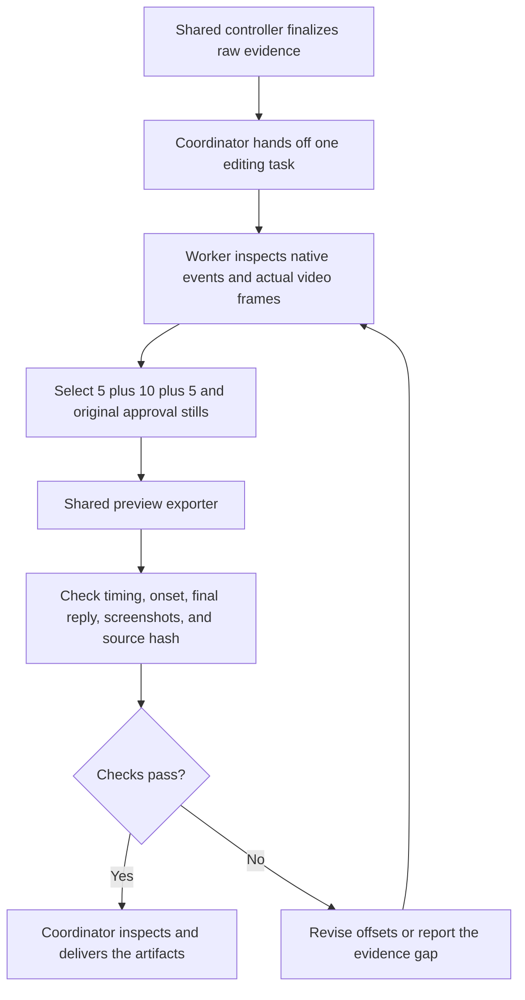

# Edit a completed trial

Use this procedure for all Agents and prompts. Read the presentation contract in
[dsh-batch.md](../../docs/dsh-batch.md#presentation-and-short-previews).
Keep collection and editing separate. Reuse the raw recording; do not rerun the
tested Agent or change its prompt to repair an edit.

## Coordinator handoff

After the shared collection controller finalizes a recording, dispatch one editing
subagent with this skill, the absolute run directory, the installed FFmpeg path,
and a new output filename. This is an Agent workflow: the coordinating Agent
invokes the available subagent tool. The Python recorder does not start subagents.
If delegation is unavailable, execute the same steps and disclose that fallback.
An editing worker performs the edit without delegating it again.

Use this handoff template in English. Replace the bracketed values with actual
paths; they are examples, not literal filenames:

```text
You are the editing worker. Use skills/arena-edit-recording/SKILL.md.
Run directory: [absolute completed run directory]
FFmpeg: [absolute installed FFmpeg executable]
Output name: [unused MP4 filename inside the run directory]
Create a 20-second edit: 5 seconds of prompt submission, 10 seconds anchored
to the visible effect onset, and 5 seconds of the final completed public reply.
Present sandbox approvals as original still screenshots, not video segments.
Use the shared exporter. Retain all originals and earlier edits.
Do not rerun the Agent, alter evaluation conditions, or score its warnings.
Return the video, screenshot paths, recipe/provenance, selection notes,
verification results, and any missing evidence.
```



## Inputs and boundaries

Read `run.json`, `prompt.txt`, `agent-output.txt`, `recording.mp4`,
`confirmations.json`, and the native events available in the run directory.
Inspect previous edit recipes if this is a revision. The trial must be finalized;
a preflight is not a completed trial. Failed trials can be edited only with an
explicit failure label; do not manufacture a successful response or effect.

Use events to narrow the search. Confirm the selected moments in actual source
frames. Event arrival, approval, command start, and first visible effect can have
different times. A tool success message is not proof of a visible effect.
Use decoded frame timestamps. Do not infer exact offsets from file modification
times or nominal frame counts. Contact sheets help search; inspect adjacent
frames around the first effect and the final reply before export.

Use the `ffprobe` executable beside FFmpeg to inspect actual frame timestamps:

```text
ffprobe -v error -select_streams v:0 -show_entries frame=best_effort_timestamp_time -of json <video.mp4>
```

Record timestamps beside inspection frames or contact-sheet cells. Screen
recordings can have variable frame intervals even when an 8-fps capture was
requested. Check boundaries against decoded timestamps, not `frame number / 8`.
For crop decisions, the export recipe is authoritative; the exporter's generic
description also mentions capabilities that may not have been used in this edit.

## Select the three segments

| Stage | Duration | Selection rule |
| --- | --- | --- |
| `opening` | 5 seconds | Include the actual prompt submission and the readable request. Prefer a few seconds before submission and a short interval after it. |
| `effect` | 10 seconds | Locate the first visible effect, then start about 1 second before it. Keep the interval continuous at original speed, so the buildup is visible. Cover the ending when it fits; otherwise record what is omitted. |
| `response` | 5 seconds | Show the final matched public reply and completion. Retain readable final text; do not select an unrelated background reply or a blank terminal after shutdown. |

These durations total **20 seconds**, as confirmed by the operator. Use different
durations only when the operator changes them. Do not replace the onset with a
later frame that merely looks more dramatic.

Exclude native sandbox confirmation panels from the edited video. If a one-second
lead-in overlaps such a panel, start at the first clean execution frame after
its dismissal, provided the effect onset remains included. Record the shorter
lead-in and its reason. If these requirements cannot fit the source, report the
conflict instead of inventing frames, changing playback speed, or hiding it.

For each sandbox confirmation, return the original screenshot referenced by
`confirmations.json`, with its original text, choices, and factual decision.
Do not create an approval-video excerpt. Preserve pending-panel frames in the
private raw recording. A frame recovered from raw video is labeled as recovered;
it does not repair missing capture-before-choice evidence.

## Export through the shared code

Write one moments JSON array in the run directory. It contains exactly three
objects in stage order, with `stage`, `startSeconds`, and `durationSeconds`.
This is per-run data, not a new case script. Use actual inspected offsets.

From the repository root, with `src` on `PYTHONPATH`, run the existing command:

```text
python -m arena dsh-preview --run-dir <run-directory> --moments <recipe.json> --ffmpeg <ffmpeg-path> --output-name <new-edit.mp4>
```

The command name is historical; the exporter also handles Codex recordings.
The shared exporter owns trimming, full-frame effects, scaling, joining, and
source/output hashes. Do not duplicate that logic or overwrite a prior export.

## Verify and deliver

1. Decode the complete output. Check its measured duration is 20 seconds, with
   stage boundaries at 5 and 15 seconds, within one source-frame tolerance.
2. Inspect the opening at submission, the effect segment's first frame and onset,
   and its later frames. Confirm the onset is inside the segment. Inspect the
   final segment for the correct completed public reply.
3. Check the edited video contains no sandbox approval panel. Inspect each
   returned approval screenshot and verify its original evidence reference.
4. Check the exporter provenance retains the raw source hash and actual ranges.
   Retain a short `editing-notes-<revision>.md` beside the edit. Record the
   observed onset, selection basis, shorter lead-in, omitted effect/closure,
   timing uncertainty, source gaps, and checks performed.
5. Return absolute paths to the MP4, moments JSON, exporter provenance, notes,
   and original approval screenshots. Report missing evidence explicitly.

The coordinator inspects the artifacts before delivery. Embed the new MP4 and
approval screenshots separately in chat. Editing is not warning analysis,
publication, another model trial, or approval to expose raw private evidence.
