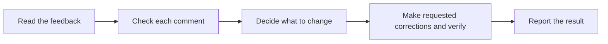

# Handle review feedback

Follow `AGENTS.md`. Verify each comment before changing code. Base decisions
on requirements and evidence. Do not accept or reject advice without checking it.

## Read and check

- Read all comments and related discussion. Identify the affected files and
  reviewed revision. Check whether later changes already address the comment.
- Read the code, callers, tests, and applicable requirements. Check the
  reported failure and the effect of the proposed correction.
- Ask for clarification when an unclear comment prevents a decision.
  Continue independent work. Do not change code that depends on the answer.
- Decide whether each comment is valid, partly valid, incorrect, or unclear.
  Give evidence for the decision. State what you could not verify.
- Check compatibility, existing design decisions, and actual usage. Do not
  add features or abstractions only because a reviewer suggests them.

## Make requested corrections

- For an assessment request, report the decisions. For a correction request,
  apply the verified fixes. Resolve conflicts with requirements before editing.
- Fix critical failures first. Make small changes. Avoid unrelated cleanup.
- For code changes, follow `skills/arena-tdd/SKILL.md`.
  For document changes, follow `skills/arena-verify/SKILL.md`.
- If the code is difficult to understand, improve the code or its comments.
  An explanation in the review thread alone does not help future readers.
- Run checks that cover each correction and its effect on related behavior.

## Report the result

- Account for every comment. State what changed, what remains open, and why.
  Support disagreements with technical facts. Keep replies brief and respectful.
- Record actual check results and verification limits. Do not claim that an
  item is fixed before verification. Correct an earlier decision if evidence changes.
- Return the result in chat. Post replies only when the user requests them.
  Reply to inline comments in their original threads. Do not resolve threads,
  push commits, or merge a PR unless the user requests that action.
