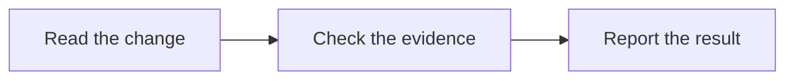

# Review a change

Follow `AGENTS.md`. Report defects caused by the change. Support each defect
with evidence. Keep optional suggestions separate.

## Read the change

- Identify the goal from the request, PR, issue, or specification. State any
  missing information. Do not invent requirements.
- For a PR, read its description, diff, base branch, and head commit.
  Compare the change with its actual base. Use the current repository context.
- For local changes, read the diff and untracked files. Record the base commit
  if available. Identify uncommitted changes.
- Read changed files in full. Read related files and applicable instructions.

## Check the evidence

- Compare the change with the requirements. Check assumptions, callers, and
  relevant tests.
- Check for unnecessary complexity and unrelated changes. Treat them as
  optional suggestions unless they break a requirement or cause a failure.
- Before local PR checks, confirm that the files match the reviewed revision.
- For code, use `skills/groundwork-tdd/SKILL.md` to check test evidence.
  Run relevant checks when available. A review does not require a fix.
- For documents and skills, use `skills/groundwork-verify/SKILL.md`.
  Check facts, links, and instruction conflicts. Test runs are not required
  for document changes alone.
- Confirm how each defect causes a failure. Missing CI or an optional section
  is not sufficient evidence of a defect.
- Look for evidence that could disprove each finding. Remove false positives,
  duplicate findings, existing defects, and personal style preferences.

## Report the result

- List confirmed defects first. Give the priority, file, line range, failure
  condition, effect, and suggested correction.
- Use P0 for an immediate critical failure, P1 for an urgent defect,
  P2 for a normal defect, and P3 for a minor defect.
- If no defects are confirmed, say so. Identify optional suggestions as such.
- State the reviewed revision or local diff, check results, and verification
  limits. Report command errors. Do not report unrun checks as passed.
- Return the review in chat. Publish comments or change files only when the
  user requests that action.
