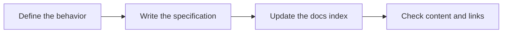

# Write a specification

Follow the communication and documentation rules in `AGENTS.md`.

A specification states observable behavior. Code follows the specification.
Write it before you define an API, CLI, or architecture.



## Rules

- Put each specification at `docs/<topic>.md`. Use lowercase letters,
  numbers, and hyphens in the topic name.
- Create `docs/README.md` when you add the first specification or decision.
- Add or update its row in `docs/README.md` in the same change.
- Write in English. Use stable project terms.
- Keep details in the specification. A skill links to it without copying it.
- Add a glossary under `docs/` only when a term is stable. Keep implementation
  details out of the glossary.
- Add a decision at `docs/adr/<topic>.md` only when you know the context, decision,
  and consequences. Add it to the docs index.

## Index

Use one table row per document in `docs/README.md`.

```markdown
| Doc | Use |
| --- | --- |
| [topic.md](topic.md) | States when a reader needs this specification. |
```

## Sections

Use these sections in this order:

1. **Problem.** State what is missing and why the user needs it.
2. **Behavior.** State inputs, outputs, failures, and limits. Assign an ID
   such as `AC-1` to each measurable acceptance criterion.
3. **Out of scope.** State excluded behavior.
4. **Decisions.** State settled choices. Link the relevant technical decisions.
5. **Tests.** Name the behavior to test and the evidence required for each criterion.

Use Mermaid to show steps, decisions, and system connections. A specification
can define future tests before a test runner exists. Pure document changes
do not require RED/GREEN tests.

After the edit, use `skills/groundwork-verify/SKILL.md`.
