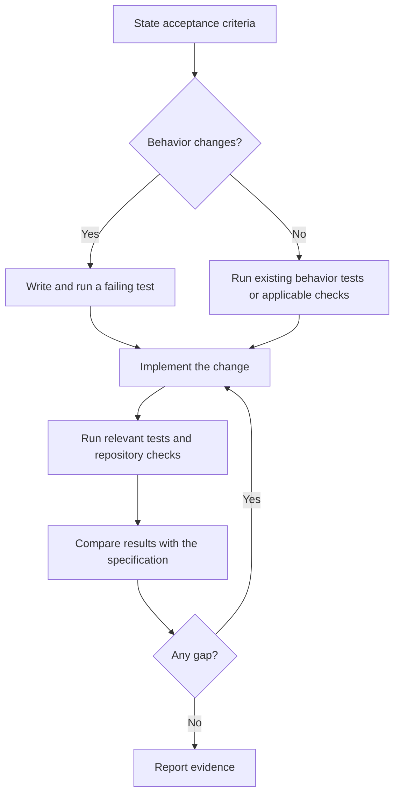

# Test code behavior

Follow the communication and documentation rules in `AGENTS.md`.

Decide the test workflow from observable behavior. A one-line change can
change behavior and require a failing test. Pure document changes use
`skills/groundwork-verify/SKILL.md` and do not require RED/GREEN tests.

For new or changed behavior, write and run a failing test before implementation.
For a refactor that preserves behavior, run the existing behavior tests before
and after. If those tests do not cover the behavior, add coverage first.
For an edit with no behavior effect, explain that judgment and run relevant
checks. Do not skip a failing test because the change is small.



## 1. State criteria

Translate the requirement into checks that pass or fail. Map each `AC-n`
criterion to a named test or an agreed manual check. For a bug fix, reproduce
the reported failure. For a refactor, identify the behavior that must stay
the same. Resolve unclear requirements before dependent implementation.

## 2. Establish evidence before the change

Use the project's verified test runner. If no runner exists, write the
specification and establish the toolchain as described in `README.md`.

For behavior changes, write the test first. Name it after the behavior or
regression. Run it and confirm that it fails for the expected reason. A
missing dependency or syntax error does not prove the intended failure.
If it passes, correct the test or the diagnosis before implementation.
Record the command and failing assertion.

For a behavior-preserving refactor, record the relevant baseline test results.

## 3. Implement

Make the smallest change that meets the criteria. Avoid unrelated changes.
Run the same tests again. Do not weaken, remove, or skip a failing test to
make the result pass. Optimize only after the tests pass.

## 4. Verify and compare

Run tests that cover the change. Use `skills/groundwork-verify/SKILL.md` for
repository checks. Map each acceptance criterion to evidence or a remaining
gap. Report gaps that affect correctness or a stated requirement.

## 5. Report evidence

Include this evidence for code changes. Use N/A with a reason when a phase
does not apply. Name checks that could not run. Do not report them as passed.

```text
RED or BASELINE: <command, result, and expected failure or baseline>
GREEN: <command and result after the change>
VERIFY: <commands, results, and acceptance criterion gaps>
NOT RUN: <checks and reasons, or none>
```
