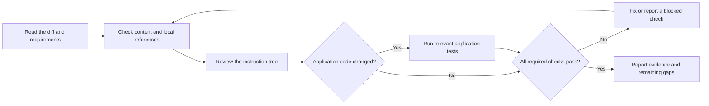

# Verify a change

Follow the communication and documentation rules in `AGENTS.md`.

Use local commands first. Add CI only when the project needs it. For code
changes, establish the evidence required by `skills/groundwork-tdd/SKILL.md`
before implementation. Return to that skill to compare and report results.



## Instruction tree review

Check these conditions by reading the files and comparing the indexes:

1. `AGENTS.md` starts with the communication and documentation rules.
2. Every `skills/<name>/SKILL.md` has YAML `name` and `description` fields.
   The name matches its directory and uses the `groundwork-` prefix.
   The description is nonempty. The body has fewer than 500 lines.
3. Every skill appears exactly once in the Task guides table in `AGENTS.md`
   and in `skills/README.md`. Every index entry points to an existing skill.
4. All skill references use the canonical files under `skills/`.
5. File paths, local links, and heading anchors resolve. Mark example paths
   clearly. Check remote links when they change.
6. There are no tool-specific skill copies or `.cursor/rules/*.mdc` files.
   Keep one skill tree at `skills/`.
7. Document facts, terms, and instructions agree with the requirements.
8. After a rename or migration, search for obsolete names and fixed addresses.

Record each failure and its cause. Correct the failures before reporting success.

## Local checks

Check whitespace with:

```bash
git diff --check
```

Include new files in the review. This command checks tracked changes only.

When the application toolchain exists, record its verified test, format,
and analysis commands here. Run checks that apply to the changed behavior.

## Report

For document changes, record content and link checks in prose. RED/GREEN tests
are not required. For code changes, use the TDD evidence block. State actual
commands, results, remaining gaps, and checks that could not run. Do not infer
success from a command that you did not run or whose output you did not read.
